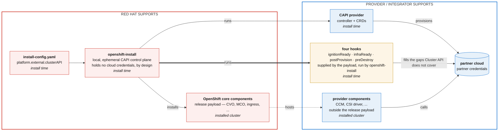
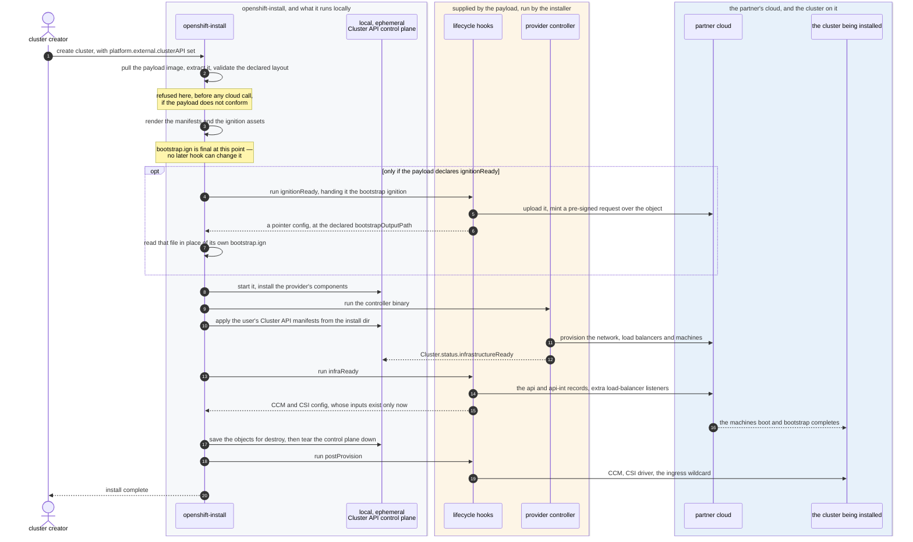
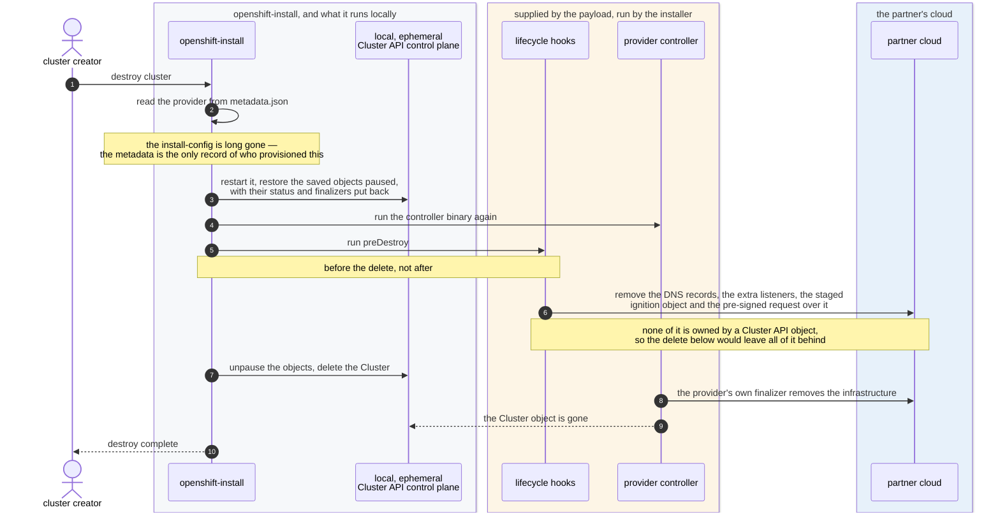

# Install a platform External cluster with a partner-supplied Cluster API provider

## Summary


`platform: external` is the supported way a provider integrates OpenShift with their own cloud components — their CCM, their CSI driver — with no provider code in the release payload. What it specifies today is the running cluster. Installation stays on the agnostic path: the user supplies the infrastructure, and the installer takes it from there.
A partner who already maintains a Cluster API infrastructure provider cannot use it at install time, so clusters on their platform are stood up by Assisted Installer or UPI and the infrastructure is created outside the installer's control.

This enhancement lets `openshift-install create cluster` provision
infrastructure for a `platform: external` cluster by running a Cluster
API provider **out-of-tree**. The provider's controller binary, component
manifests, cluster and day-0 manifest templates and lifecycle hooks are
supplied as a single **provider-published container image payload**, which
the partner builds, signs and versions through their own release process.

The image is the only supply form. The pilot proved the mechanism with a
second one — the same artifacts as filesystem paths on the installer host —
which is not carried into the API; it is recorded under Alternatives.
The installer's existing local, ephemeral Cluster API control plane runs
them exactly as it runs the providers it embeds. Four lifecycle hooks, declared
by the payload rather than by the cluster creator, cover the cloud-specific work
the installer cannot do, because on `platform: external` it holds no cloud
credentials by design.

The design is deliberately provider-agnostic: there is no Provider-specific
(AWS-specific, OCI-specific, etc) code path. It has been exercised end to
end on two providers, one reference provider embedded in the
installer (AWS/CAPA) and one with no OpenShift-specific code at all: Oracle's CAPOCI.

The scope in one picture. The two outer boxes are the support boundary: what Red
Hat supports, and what the provider or integrator supports. Inside each, the left
half is install time and the right half is the installed cluster. The boundary
runs through both phases — a partner owns their provider at install time *and*
their CCM and CSI afterwards. Nothing in the installer's local Cluster API
control plane, least of all its Secrets, reaches the installed cluster.

Note where the hook arrows start. The hooks sit on the provider's side of the
boundary because the payload supplies them and the partner supports them, but
`openshift-install` is what executes them — the provider's controller neither
invokes a hook nor knows one exists.



Red Hat supports the release payload and the installer interface the provider
plugs into. The provider supports everything it ships, at install time and
afterwards. The installer runs the partner's provider exactly as it runs the
providers it embeds, and holds no cloud credentials of its own on this platform
— which is why the hooks exist.


## Motivation

Partners and customers deploying OpenShift on an external platform get a materially
different install experience from integrated platforms. Oracle Cloud Infrastructure
is the concrete driver, but the gap is general: any partner with a working Cluster
API provider carries the whole provisioning burden themselves.

`OCPSTRAT-1322` covers the day-2 half of this problem — enabling a partner CAPI
provider in-cluster for autoscaling and machine health checks. It explicitly
does not cover install-time provisioning. This enhancement is the day-0 half.

### User Stories

* As a cloud provider partner with an existing Cluster API infrastructure provider,
  I want OpenShift's installer to run my provider during install, so that my customers
  get an IPI-like experience without Red Hat writing and maintaining in-tree support
  for my platform.
* As a cloud provider partner, I want to plug my provider in without forking the installer
  or getting code merged into the OpenShift release payload, so that my release cadence is
  mine.
* As a cluster administrator installing on a partner platform, I want 
  `openshift-install create cluster` and `openshift-install destroy cluster` to work the
  way they do everywhere else, so that my automation and my mental model carry over.
* As an OpenShift installer maintainer, I want external-platform support to add no risk to
  integrated platforms, so that I can review these changes quickly and trust the blast
  radius.
* As a Red Hat support engineer, I want to be able to tell immediately whether a failed
  install failed in Red Hat code or in a partner-supplied component, so that I route the
  case correctly.

### Goals

* `openshift-install create cluster` provisions infrastructure for a `platform: external`
  cluster using a Cluster API provider supplied by the user at install time.
* `openshift-install destroy cluster` removes that infrastructure through the same
  provider that created it.
* The contract a partner must satisfy is documented, stable and provider-agnostic.
* The partner supplies credentials to their own provider without the installer handling
  them and without forking the installer.
* No behavioural change whatsoever for any integrated platform, or for `platform: none`.
* CI covers at least one external-platform CAPI install path continuously.

### Non-Goals

* **The day-2 machine-management surface.** Autoscaling, machine health checks, MachineSet
  adoption and pivoting Cluster API controllers into the installed cluster are
  `OCPSTRAT-1322`. The Cluster API control plane this enhancement uses is local to the
  installer process and ephemeral; nothing from it reaches the installed cluster.
* **Changing how integrated platforms provision.** No existing platform's behaviour,
  validation or artifact resolution changes.
* **Shipping partner providers in the OpenShift release payload.** Everything the partner
  supplies is out-of-payload, by definition of `platform: external`.
* **Red Hat supporting partner provider code.** The support boundary is a deliverable of
  this work, not an obligation it creates.
* **Publishing boot images for partner platforms.** Tracked separately; see
  [Open Questions](#open-questions-optional).
* **Automatic CSR approval for externally-provisioned nodes.** A pre-existing gap on both
  `platform: external` and `platform: none`; see
  [Open Questions](#open-questions-optional).
* **Clouds for which Ignition has no platform provider.** This is a precondition of the
  mechanism rather than a non-goal in the usual sense, and it is stated here because
  nothing else in this enhancement states it. RHCOS reads its configuration through an
  Ignition *platform provider*, selected by the `ignition.platform.id` kernel argument,
  and upstream Ignition compiles in 31 of them
  ([`coreos/ignition`, `docs/supported-platforms.md`][ign-platforms]). On a cloud absent
  from that list there is no channel by which a configuration can reach the machine at
  all — no hook can substitute for it, because every hook in this design still delivers
  Ignition. Of the sixteen Cluster API providers surveyed in the
  [provider benchmark](#benchmark-the-proposal-against-sixteen-cluster-api-providers), two are in this position: IONOS Cloud and Huawei Cloud. Adding a platform
  provider is upstream Ignition work plus an RHCOS build, and is out of scope here.

## Proposal

The installer already stands up a local Cluster API control plane during bootstrap and
runs infrastructure providers against it; this is the mechanism described in
*bootstrapping-clusters-with-capi-providers*. Today that control plane may only run
providers whose binaries are embedded in the installer image.

This enhancement adds, for `platform: external` only:

1. An install-config stanza, `platform.external.clusterAPI`, naming the provider and the
   payload image that carries its controller, component manifests, templates and hooks.
2. Resolution of that payload in place of the embedded artifact archive, with validation
   before any side effect.
3. Acceptance of Cluster API manifests whose `kind` has no compiled-in Go type, scoped to
   the external provisioning path.
4. Four lifecycle points — `ignitionReady`, `infraReady`, `postProvision`,
   `preDestroy` — at which the
   installer runs a program the provider payload declares, for cloud-specific work the
   installer cannot perform. These are declared in the payload's own descriptor, not in
   `install-config.yaml`: a hook is an integrator's interface, not a cluster creator's.
   Three of the four are unconditional; `ignitionReady` is declared only by providers
   whose controller cannot stage an oversized bootstrap ignition itself, and it is the
   only hook whose output the installer reads back.
5. Recording of the provider in cluster metadata, so `destroy cluster` can tear down
   through the same provider.
6. A hidden `openshift-install extract cluster-api <provider>` command that writes an
   embedded provider's artifacts to a directory, so a partner can see the exact shape the
   contract expects. (not mandatory, well used in the Pilot to reproduce stable CAPI with platform type external in integrated providers)

   **Decided: `extract` emits a complete reference implementation, in input layout.** Today
   it writes two things — the controller binary and
   `<name>-infrastructure-components.yaml` (`pkg/clusterapi/extract.go:95,105`). That is
   enough to prove the artifacts exist and not enough to be a worked reference. The
   intended behaviour is that `extract` writes **the binary, the provider's infrastructure
   CRDs and components, and the cluster manifests** for the named provider, laid out in
   **exactly the directory shape the installer expects as input** — so that a partner's
   first action is to diff their own tree against it, and their second is to run it.
   Concretely, the output directory is a **payload root** — the layout `openshift.yaml`
   declares and `openshift-install external-payload init` scaffolds: the controller binary,
   the components file, Cluster API templates, day-0 manifest templates and a descriptor
   naming them. A partner's build then only has to put that directory in an image.

   Two things follow and are not yet settled. The cluster manifests are asset-graph output
   (`pkg/asset/manifests/clusterapi/cluster.go:212`), not embedded files, so producing them
   requires either a minimal install-config as input to `extract` or templated manifests
   with placeholder substitution; and whichever is chosen fixes the answer to "do partners
   ship manifests or manifest templates?" below. See Open Question 1.

#### The lifecycle in two sequences

Both halves of the proposal, as who-calls-whom. The grey lane is `openshift-install` and
the scratch control plane it runs locally; the amber lane is what the payload supplies and
the installer executes; the blue lane is the partner's. Read the diagrams for one thing
before anything else: **the `openshift-install` lifeline has no arrow into the partner
cloud, in either direction, in either sequence.** That is not a simplification of the
drawing — it is the constraint the whole design follows from, and every hook in the
proposal exists because of it.

Install:



Three things in that sequence are worth pausing on. The bootstrap ignition becomes final
at the second message — it is asset-graph output, resolved before provisioning begins —
which is why `ignitionReady` has to sit where it does and why no later hook could do its
job. The `ignitionReady` exchange is the only one in the whole proposal where a hook
*returns* something the installer reads; every other hook arrow is one-way, and the
dashed replies from `infraReady` are files written to a directory the installer named,
not a channel. And the local Cluster API control plane's lifeline ends before
`postProvision` is called, so that hook talks to the installed cluster rather than to the
installer's scratch control plane: Secrets created in the latter never reach the former.

Teardown:



Teardown is deliberately provider-agnostic: it restores the saved Cluster API objects,
runs the hook, deletes the `Cluster` and waits for the provider's finalizer. It contains
no cloud SDK and no per-platform branch, which is what lets one implementation serve every
partner — and is also why a resource no Cluster API object owns can only be removed by
`preDestroy`.

### Workflow Description

**Partner provider developer** is a human who maintains a Cluster API infrastructure provider for a platform that OpenShift does not integrate in-tree.

**Cluster creator** is a human or automation installing OpenShift on that platform.

Provider preparation, done once by the **partner provider developer**:

1. Build the provider's controller binary for the installer's host architecture.
2. Collect the provider's component manifests — CRDs, RBAC, webhook configuration — into
   the single `infrastructure-components.yaml` bundle `clusterctl` already requires.
3. Write the Cluster API manifest templates for a cluster on that platform, the day-0
   manifest templates their cloud needs, and the optional hook programs.
4. Write the payload descriptor, `openshift.yaml`, declaring the layout. The installer
   validates it, and it is what lets a partner name their own paths rather than adopt the
   installer's. For the AWS/CAPA reference provider:
```yaml
# Provider payload descriptor for the AWS/CAPA reference example.
#
# This file is the OpenShift-specific half of the payload contract. The other
# half is clusterctl's own metadata.yaml, which sits next to this file at the
# payload root and is copied verbatim from the provider repository by the
# Containerfile. metadata.yaml answers "which Cluster API contract does this
# provider release implement"; it says nothing about Kubernetes versions and
# nothing about where the controller binary or the hooks live, because neither
# concept exists upstream. That residue is what this file carries.
#
# Everything here describes structure. The installer validates that the
# declared layout is present and that the compatibility range admits the
# release being installed; it does not inspect, scan or attest the controller,
# the manifests or the hooks. Correctness of the content is the provider's
# responsibility, established by their release process.
apiVersion: external.openshift.io/v1alpha1
kind: ProviderPayload

# Compared against the Kubernetes version this installer binary was built
# against. Outside this range the install is refused, before any cloud call.
# Not the release image's Kubernetes version: the installer does not read one
# out of the release, and with OPENSHIFT_INSTALL_RELEASE_IMAGE_OVERRIDE the
# two can differ. Reading it from the release instead is a design question,
# not a detail -- see Open Question 14.
#
# Only 1.36 (OpenShift 5.1) is exercised in CI today. The wider band below
# illustrates the shape of the contract; it is not a tested claim, and a
# provider publishing a real payload is asserting something their own release
# process has verified.
compatibility:
  kubernetes:
    min: "1.33"
    max: "1.37"

# Paths are relative to capiInstallerPath -- the directory the payload is
# extracted into, which defaults to <install-dir>/capi-installer. A conforming
# payload therefore needs no path configuration in install-config.yaml at all.
#
# Validation is exhaustive: every declared path must exist, the controller must
# be executable, and an executable the payload did not declare is rejected. An
# undeclared helper script is not "extra", it is a payload that fails to
# install.
layout:
  # The same path for every provider, so layout validation does not have to
  # know that AWS calls its binary `manager`. Two example builds produce it:
  # CAPA.Containerfile copies it out of the provider's own released controller
  # image, and Containerfile builds it from provider source.
  #
  # Either way the binary must be demonstrably the one the installer was
  # handed rather than one it already embedded. On AWS that distinction is the
  # whole point: the installer embeds CAPA, so a payload that reused the
  # embedded build would prove nothing. CAPA.Containerfile settles it by
  # shipping a *different*, upstream-released CAPA version from the one the
  # installer vendors -- the version logged at controller startup is then
  # proof of which binary ran.
  controller: bin/controller

  # A single file, not a directory. Every clusterctl provider already publishes
  # exactly one infrastructure-components.yaml.
  #
  # Only its CustomResourceDefinitions and webhook configurations are applied:
  # the installer runs the controller as a local OS process, so the Namespace,
  # RBAC, Deployment and credentials Secret the bundle also contains are never
  # applied to the local control plane. That is why the provider's own
  # published bundle can be used unmodified and still carry no credential -- its
  # ${AWS_B64ENCODED_CREDENTIALS} slot is inert here, and the controller takes
  # its credentials from the environment the installer starts it in.
  customResource: infrastructure-components.yaml

  # Cluster API objects -- Cluster, AWSCluster, Machine, AWSMachine -- applied
  # to the installer's local, ephemeral Cluster API control plane. Nothing in
  # this tree reaches the installed cluster.
  clusterTemplates: cluster-api/

  # Day-0 manifests folded into <install-dir>/manifests/ and applied by
  # bootstrap. These do reach the installed cluster. A different destination
  # and a different lifetime from clusterTemplates above, which is why the two
  # are separate keys rather than one rendered directory.
  manifestTemplates: manifests/

  # One script may serve every phase, dispatching on the
  # OPENSHIFT_INSTALL_HOOK environment variable the installer sets. It is
  # declared once per phase rather than left as an undeclared helper because an
  # executable the payload did not declare is rejected.
  #
  # Hooks are copied verbatim, never rendered. This script expands
  # ${OPENSHIFT_INSTALL_INFRA_ID}, ${REGION} and others as *shell* variables at
  # run time; substituting them at render time would destroy it.
  #
  # CAPA stages an oversized bootstrap ignition itself -- the installer hands it
  # the full ignition in a Secret and the controller uploads it to the bucket
  # declared on AWSCluster.spec.s3Bucket -- so this payload declares no
  # ignitionReady. See the CAPOCI descriptor under API Extensions for one that
  # does, and Risks for why the two differ.
  hooks:
    infraReady:
      program: hooks/infra-ready.sh
    postProvision:
      program: hooks/post-provision.sh
    preDestroy:
      program: hooks/pre-destroy.sh

```
5. The result is one tree. Below is the AWS/CAPA reference provider's, carrying the
   Cluster API templates, the hooks, and the day-0 manifests that deliver the cloud
   controller manager and the ingress load-balancer `Service`:
```sh
$ tree payload/
payload/
├── cluster-api
│   ├── cluster.yaml
│   └── machines
│       ├── 10_bootstrap.yaml
│       ├── 20_master.yaml
│       └── 30_worker.yaml
├── hooks
│   ├── infra-ready.sh
│   ├── lib
│   │   └── common.sh
│   ├── post-provision.sh
│   └── pre-destroy.sh
├── manifests
│   ├── 99_external-00-kubelet-providerid-master.yaml
│   ├── 99_external-00-kubelet-providerid-worker.yaml
│   ├── 99_external-02-ccm-aws.yaml
│   └── 99_external-03-ingress-nlb.yaml
└── openshift.yaml

```
6. Assemble that tree into an OCI image and publish it through their own release process.
   Nothing about the build is OpenShift-specific: the image filesystem *is* the payload,
   so an ordinary `Containerfile` that copies these paths in is the whole of it. A worked
   reference implementation, buildable and publishable end to end, is
   [cluster-api-provider-foo-openshift](https://github.com/mtulio/cluster-api-provider-foo-openshift).

Install time, done by the **cluster creator**:

1. Write `install-config.yaml` with `platform.external.clusterAPI` pointing at the
   provider payload image.

  **The proposed form: a provider-published CAPI installer image.**
  **FOO provider with CAPFOO**

  A single image, built, signed and maintained by the FOO provider, resolving
  provider-specific concerns such as CAPI version skew and infrastructure hooks (for
  resources CAPI does not model) inside one versioned artifact.

  > The pilot proved the mechanism with a second form — the provider supplied as
  > **filesystem paths** on the installer host. It is **not carried into the proposed
  > API**: a partner with a controller on disk builds a payload image from it and uses
  > the one form everyone else uses. The pilot's evidence for that form is recorded in
  > full under [Alternatives](#alternatives-not-implemented).

  ```yaml
  platform:
    external:
      platformName: foo
      cloudControllerManager: External
      clusterAPI:
        name: foo

        # Where the provider comes from. One payload image.
        controller:
          image:
            ref: quay.io/foo/openshift-capfoo@sha256:CHANGE-ME

        # Extra flags appended to the controller's command line.
        args: []

        # Values for the provider's own ${VAR} tokens in the payload's template
        # trees. This is the cluster creator's customisation interface, and the
        # only part of the stanza a conforming payload requires them to write.
        # INSTALLER_-prefixed names are reserved to the installer and rejected
        # here. Variable names are recorded in the install log.
        variables:
          FOO_REGION: us-east-1

        # Everything below is optional and shown only to say what it means. A
        # conforming payload needs none of it.
        #
        # Paths are relative, never absolute: capiInstallerPath is relative to
        # the install directory and must stay inside it, and the two below are
        # relative to the extraction root, so an override selects between
        # things the payload shipped rather than reaching outside it.
        #
        # capiInstallerPath: capi-installer       # default
        # customResource: infrastructure-components.yaml
        # manifestPath: manifests
        #
        # There is no hooks stanza. Hooks are declared by the payload, in
        # openshift.yaml -- see "Hooks are the integrator's interface" below.
  ```

  **How the payload is obtained and used.** In order:

  2. The installer pulls it over the registry API, authenticating with `pullSecret` and
     redirecting through `imageDigestSources`. **A disconnected or air-gapped install
     mirrors the payload to a reachable registry**; there is no "point at an image in the
     local container store" mode, because the installer speaks to a registry and does not
     read podman's or docker's image storage.
  3. The installer extracts the image content — controller binary, infrastructure
     components, both template trees, hooks — into `capiInstallerPath`, which defaults to
     `<install-dir>/capi-installer`. Every other path in the stanza is defaulted beneath
     it, so a conforming payload needs no path configuration at all.
  4. The installer renders both template trees, substituting its own
     `INSTALLER_`-prefixed variables — `INSTALLER_INFRA_ID`, `INSTALLER_BASE_DOMAIN` and
     the rest of the published set — plus the user's `variables`, using clusterctl's
     `${VAR}` syntax. A variable the installer cannot resolve fails before any cloud call.
     The Cluster API tree lands where a hand-written one would, and the day-0 manifest
     tree lands in the extra-manifest directory, so a payload install and a hand-written
     one are the same install from that point on — which is what makes the two CI arms
     comparable.

  **On signing and trust.** The payload is built, maintained and shipped by the provider
  through their own release process, and that is the trust boundary. **The installer
  validates the payload's *structure*, not its *content*.** It checks that the expected
  layout is present and that the declared compatibility range admits this release; it does
  not inspect, scan or attest the controller, the manifests or the hooks. Correctness of
  what is inside is the partner's responsibility, established by their release process and
  by the validation model in the partner delivery work — not by an installer-side check.

  **The payload layout is clusterctl's, not a new one.** Before inventing a format it is
  worth noting that the three things this option needs are already conventions every
  Cluster API provider follows, because `clusterctl` requires them of a provider
  repository. Verified in both pilot providers:

  | Need | Existing convention | Evidence |
  | --- | --- | --- |
  | One components bundle | `infrastructure-components.yaml`, a single file | why `customResource` is a file, not a directory |
  | Declared contract version | `metadata.yaml`, `apiVersion: clusterctl.cluster.x-k8s.io/v1alpha3`, `kind: Metadata`, mapping each release series to a Cluster API contract (`v1beta1`, `v1beta2`) | `cluster-api-provider-aws/metadata.yaml`, `cluster-api-provider-oci/metadata.yaml` — both present and published today |
  | Manifest templates | `cluster-template*.yaml` with `${VAR}` substitution, including `${VAR=default}` and `${VAR:="default"}` | `cluster-api-provider-oci/templates/cluster-template.yaml` uses `${CLUSTER_NAME}`, `${KUBERNETES_VERSION}`, `${NAMESPACE}` among others |

  So the payload should **reuse `metadata.yaml` verbatim** for Cluster API contract skew.
  A partner publishes it already; requiring it costs them nothing and the installer gets
  the one skew answer that matters most — which Cluster API contract the controller
  implements — from a file whose semantics are defined upstream rather than by us.

  **What clusterctl does not cover, and we therefore still need.** `metadata.yaml` maps
  release series to a *Cluster API contract*. It says nothing about Kubernetes or
  OpenShift versions, and nothing about where the hooks and the controller binary live —
  neither concept exists upstream. That residue is small enough to carry in a second file
  at the payload root, deliberately shaped like `metadata.yaml` so the two read as a pair:

  ```yaml
  # <capiInstallerPath>/openshift.yaml
  apiVersion: external.openshift.io/v1alpha1
  kind: ProviderPayload
  # Compared against the Kubernetes version the installer was built against; the
  # install is refused outside the range. The Cluster API contract comes from the
  # adjacent clusterctl metadata.yaml and is not repeated here -- and is not
  # checked today; see Version Skew Strategy.
  compatibility:
    kubernetes:
      min: "1.32"
      max: "1.34"
  # Paths relative to capiInstallerPath, so the installer validates structure rather
  # than guessing it. This is the OpenShift-specific part: clusterctl has no notion
  # of a controller binary on disk or of install-time hooks. Validation is
  # exhaustive: every declared path must exist, the controller must be executable,
  # and an executable the payload did not declare is rejected.
  layout:
    controller: bin/controller
    customResource: infrastructure-components.yaml
    # Two template trees, not one. clusterTemplates is applied to the
    # installer's local, ephemeral control plane and reaches nothing;
    # manifestTemplates is folded into the install directory's manifests and
    # does reach the cluster. Same rendering, different destination and
    # different lifetime.
    clusterTemplates: cluster-api/
    manifestTemplates: manifests/
    # Each entry is an object, not a path, because one phase carries a second
    # field. Keeping every phase the same shape is deliberate: a map whose
    # values are sometimes strings and sometimes objects is harder to validate,
    # to document and to evolve than one that is uniform from the start, and
    # v1alpha1 with two published payloads is the cheapest moment to settle it.
    hooks:
      infraReady:
        program: hooks/infraReady
      postProvision:
        program: hooks/postProvision
      preDestroy:
        program: hooks/preDestroy
  ```

  Image labels were considered as an alternative home for the same data and rejected: a
  label is queryable without extracting, but it cannot carry the layout map and cannot be
  versioned by `apiVersion`, so the payload would end up with two sources of truth for
  one contract.

  **Reference implementations.** Both pilot providers are expressed as payloads below.
  The AWS/CAPA one is the convenient arm; **the OCI/CAPOCI one is the arm that evidences
  the central claim**, because CAPOCI is not embedded in the installer. Read them
  together: the install-config side is nearly identical and nearly empty, and everything
  provider-specific has moved inside the payload, which is the result the form is chosen
  for.

  **AWS, with Cluster API Provider AWS (CAPA).**

  ```yaml
  platform:
    external:
      platformName: aws
      cloudControllerManager: External
      clusterAPI:
        name: aws
        controller:
          image:
            ref: quay.io/CHANGE-ME/openshift-capa@sha256:CHANGE-ME
        # the feature gate CAPA requires before it will accept
        # AWSMachine.spec.ignition at all -- a provider-specific flag the
        # installer knows nothing about
        args:
        - --feature-gates=BootstrapFormatIgnition=true,ExternalResourceGC=true
        variables:
          AWS_REGION: CHANGE-ME
          AWS_DNS_ZONE: CHANGE-ME
  ```

  **OCI, with Cluster API Provider OCI (CAPOCI).** Everything else defaults from the
  payload, including all four hooks. The bucket the `ignitionReady` hook stages
  into is supplied as an ordinary payload `variable`, not as an installer field:
  the installer provides the hook and the output-path contract and knows nothing
  about object storage.

  ```yaml
  platform:
    external:
      platformName: oci
      cloudControllerManager: External
      clusterAPI:
        name: oci
        controller:
          image:
            ref: quay.io/CHANGE-ME/openshift-capoci@sha256:CHANGE-ME
        args:
        - --init-oci-clients-on-startup=false
        # Consent to the payload's ignitionReady hook, which is the only
        # hook that reads the cluster's bootstrap ignition. A payload that
        # declares ignitionReady while this is absent or Disabled is refused
        # at validation, before any cloud call. An enum rather than a boolean
        # so a later third state -- "only from a signed payload", say -- is an
        # addition rather than a replacement.
        bootstrapIgnitionStaging: Allowed
        variables:
          OCI_COMPARTMENT_ID: CHANGE-ME
          OCI_REGION: CHANGE-ME
          # consumed only by the payload's ignitionReady hook
          OCI_IGNITION_BUCKET: CHANGE-ME
  ```

  ```yaml
  # inside the CAPOCI payload: <capiInstallerPath>/openshift.yaml
  apiVersion: external.openshift.io/v1alpha1
  kind: ProviderPayload
  compatibility:
    kubernetes:
      min: "1.32"
      max: "1.34"
  layout:
    # NOT the CAPOCI binary: a wrapper translating the installer's
    # --health-addr into the provider's --health-probe-bind-address, the one
    # installer-supplied flag CAPOCI does not declare. It must translate
    # rather than drop the flag -- the installer polls /healthz at exactly
    # the address it passed. A layout.controller that is a wrapper is legal
    # on purpose, and this is why.
    controller: bin/capoci-shim.sh
    customResource: infrastructure-components.yaml
    clusterTemplates: cluster-api/
    manifestTemplates: manifests/
    hooks:
      # CAPOCI base64s machine user data into instance metadata
      # (cloud/scope/machine.go:353). OCI caps instance metadata at 32,000
      # bytes -- a service limit, not a check in the provider's code, so the
      # failure surfaces from the cloud API rather than from CAPOCI -- against
      # a bootstrap.ign of hundreds of kilobytes. The provider has no
      # object-store offload of its own, so the payload stages the ignition
      # itself and hands the installer a pointer config back.
      ignitionReady:
        program: hooks/ignitionReady
        # Required whenever ignitionReady is declared. The name says
        # bootstrap because that is the only ignition this hook may replace;
        # a second field would be needed to touch master or worker, and none
        # is proposed. Relative to a directory the installer creates for the
        # hook and removes afterwards -- the partner names the file, the
        # installer decides where it lives.
        #
        # It must not be named bootstrap.ign. That name belongs to the
        # installer's own output, and a hook writing it would leave two files
        # with one name and no way to tell, from either, which the installer
        # consumed. Validation rejects the collision rather than resolving it.
        #
        # After the hook returns the installer reads this path, refuses the
        # install if it is absent or does not parse as an Ignition config, and
        # logs only the size and SHA-256 of what it read.
        bootstrapOutputPath: bootstrap-staged.ign
      # creates api/api-int DNS; adds a 22623 listener and backend set to the
      # API load balancer, which CAPOCI has no field for; and writes the CCM
      # and CSI config Secrets, whose inputs are OCIDs that do not exist until
      # Cluster API has built the network -- so they cannot be day-0 manifests
      infraReady:
        program: hooks/infraReady
      postProvision:
        program: hooks/postProvision
      preDestroy:
        # also deletes the staged ignition object and the pre-signed request
        # ignitionReady created
        program: hooks/preDestroy
  ```

  **What moving CAPOCI into a payload changes, and what it does not.** The mechanism is
  unchanged; what changes is where the provider-specific knowledge lives.

  * The `--health-addr` shim stops being something the cluster creator has to know about
    and write a path to. It becomes `layout.controller` inside the artifact the partner
    publishes, which is the party that knows the flag is undeclared.
  * The hooks stop being separate files the creator places and wires per phase. The
    payload declares them and the installer defaults each phase from the layout.
  * The pilot's three-phase install — `create ignition-configs`, offload the bootstrap
    ignition by hand, then `create cluster` — collapses back into a single
    `create cluster`. The offload becomes the payload's `ignitionReady` hook, and the
    bucket name becomes a payload variable rather than an environment variable the
    cluster creator has to export around the installer.
  * `postProvision` loses its `--input-service=openshift-ingress/router-external-default`
    argument: a payload hook has nowhere to carry an argument list, so a partner folding a
    hook into a payload folds its flags into the program's own defaults.
  * The CCM and CSI configuration that the pilot's `infraReady` wrote as Secrets stays in
    the hook. Their inputs are OCIDs that do not exist until Cluster API has built the
    network, so they cannot become `manifestTemplates` — the payload moves delivery, not
    the ordering constraint.
  * Nothing in the installer becomes OCI-aware. The AWS and OCI stanzas above differ only
    in the image reference, the provider's own flags and the provider's own variables.

  **Decided on the payload image:**

  * **The payload image is the only supply form, so `controller` is not a union.** The
    pilot's filesystem-path form is not carried into the API: a partner iterating on a
    controller binary builds a payload image from it, which is a documented two-file
    build and produces the same artifact their users consume. One form means one code
    path, one validation path and one CI arm, and no second contract to accidentally
    support. `controller` is still a struct rather than a bare string so that a second
    form, if one is ever accepted, can be added as a union member compatibly. See
    *API Extensions* for the shape and for what this replaces.
  * **`customResource` is a single file.** `customResourcePath` is dropped. Cluster API
    providers publish exactly one `infrastructure-components.yaml`; a directory contract
    would be a generalisation with no known consumer.
  * **An unresolvable template token fails the install.** It fails when the payload's
    templates are rendered, during `create manifests` — before any cloud call and before
    the controller starts, matching clusterctl's behaviour on an unset required variable.
    It is **not** an install-config validation error: the token lives in the payload, not
    in `install-config.yaml`, so there is no field path to attach it to and it cannot be
    reported as a `field.ErrorList` entry alongside the rest. Partners and cluster
    creators should expect it from `create manifests`, not from `create install-config`.
  * **Credentials for a private payload are the user's problem, not a new mechanism.**
    The user appends the partner's registry credentials to the existing `pullSecret`, or
    mirrors the payload into a registry they already have credentials for and redirects it
    with `imageDigestSources`. No new install-config field. Note that `pullSecret` is the
    *only* credential source: the installer writes it to a temporary `--registry-config`
    file rather than letting `oc` fall back to the host's ambient docker or containers
    auth, so the same install-config pulls the same image on another machine.
  * **A tag is accepted; the reference must be fully qualified.** Starting with tags keeps the first implementation simple. The install log records the resolved digest and the artifact SHA-256, so a tagged install is still traceable after the fact even though it is not reproducible from the install-config alone.
  * **Hooks are the integrator's interface, and the payload is their only home.** A hook
    is provider-specific work — DNS, an extra load-balancer listener, ignition staging —
    that the partner who wrote the provider is the only party able to write correctly. It
    is not a knob a cluster creator turns. So `install-config.yaml` has no `hooks` stanza
    at all: the payload declares each phase in `openshift.yaml` and the installer runs
    what it declares, resolved against the extraction root and required to stay inside it.
    `variables` is the cluster creator's interface and `openshift.yaml` is the
    integrator's, and the two do not overlap.

    An earlier design let a cluster creator override a phase with a host-local program.
    That is dropped. It bought a developer convenience and cost a second resolution root,
    a per-phase origin rule, and a mixed trust boundary in which the payload was the unit
    of trust for some hooks and not others — and the first implementation of it was
    already wrong, relocating all three hooks when one was overridden. Developers
    iterating on a hook rebuild the payload image, which is one `podman build` away.
  * **A payload hook must default its own arguments.** The layout names a program and
    nothing else, so there is nowhere in the payload for a hook to carry an argument list.
    A hook that took flags in the pilot has to fold them into the program's own defaults.

  * **Templating follows clusterctl, not Go templates, and not kustomize.** The payload
    already borrows `metadata.yaml` and the single-bundle convention from clusterctl, and
    every provider's existing `cluster-template*.yaml` already uses `${VAR}`,
    `${VAR=default}` and `${VAR:="default"}`. Adopting the same syntax means a partner
    maintains one template dialect across both their upstream and their OpenShift
    artifacts. Kustomize is not used: it is a much larger contract than variable
    substitution, and it does not naturally express "fail if this value is unset", which
    is the behaviour decided above.
  * **Variables are uppercase with an `INSTALLER_` prefix** — `INSTALLER_INFRA_ID`,
    `INSTALLER_BASE_DOMAIN`, and so on. The prefix keeps the installer-supplied set
    distinct from a partner's own variables in the same file, so the two namespaces can
    grow independently. The exact set is the partner-facing contract and is enumerated
    when the layout is published; adding a variable is compatible, renaming one is not.
  * **`openshift.yaml` stays a file; image labels are dropped.** This was decided by
    reading clusterctl's own `metadata.yaml`: its only top-level keys are `apiVersion`,
    `kind` and `releaseSeries`, and each release series entry carries only `major`,
    `minor` and `contract`. It answers "which Cluster API contract does this provider
    release implement" and says nothing about Kubernetes versions and nothing about
    layout, so it does not resolve the skew question on its own. The residue therefore
    needs a home that can be versioned and extended, which a label set is not.
  * **A mirrored payload must be referenced by digest.** `imageDigestSources` is
    digest-oriented by name and by its deprecated predecessor's split — `imageContentSources`
    was the one that handled tags. Rather than reintroduce tag mirroring, the rule is
    narrow: tags are accepted for a connected install, and a disconnected or mirrored
    install must pin the payload by digest. Validation enforces this when
    `imageDigestSources` is set.
  * **`layout` validation is exhaustive.** Every path the payload declares must exist,
    the controller must be executable, and anything executable that was *not* declared is
    rejected. This is what makes "the installer validates structure, not content" a
    guarantee rather than a slogan: a payload cannot carry unannounced executables. It is
    decided now rather than later because tightening the rule after publication breaks
    every partner already shipping.

  **Disconnected and mirrored installs reuse `imageDigestSources`.** This is not a new problem. `install-config.yaml` already carries `imageDigestSources` (`pkg/types/installconfig.go:157`), which is how a mirrored install redirects the release image before any cluster exists; the installer converts it into the in-cluster `ImageDigestMirrorSet` afterwards (`pkg/asset/manifests/imagedigestmirrorset.go:45`).
  The provider payload resolves through the same field. `pullSecret` covers authentication and `imageDigestSources` covers redirection; neither needs a new mechanism.

2. Place nothing: the installer renders the payload's two template trees
   into `<install-dir>/external-install/` and `<install-dir>/external-install/extra-manifests/`
   itself. Note the directory is `external-install/` and deliberately **not** the installer's
   own `cluster-api/` (`pkg/types/external/doc.go:23`): that one is an asset load path
   whose contents the asset store discards when an upstream dependency is dirty, and it is
   also where the installer unpacks the Cluster API and envtest binaries, so it is
   installer scratch space rather than a user interface.
   Note also that `compute[].replicas` is `0` on this platform: the installer generates no MachineSets for `platform: external` (`pkg/asset/machines/worker.go:807`), so day-0 workers are Cluster API `Machine` objects in `<install-dir>/external-install/machines/`, not a compute pool.
3. Run `openshift-install create cluster`.
4. The installer resolves and validates the provider artifacts, starts the local Cluster API control plane, installs the provider's components, runs the provider's controller, and applies the user's Cluster API manifests.
   * If the payload declares `ignitionReady`, the hook runs here — after the ignition assets are final and **before** any Cluster API object is applied, so no cloud infrastructure exists yet. It writes a replacement bootstrap ignition to the `bootstrapOutputPath` the descriptor declares, and the installer reads that file back in place of its own. This is the supported way a provider whose controller cannot stage an oversized bootstrap ignition offloads it to object storage and substitutes a pointer config.
   * The phase is given two variables nothing else sees: `OPENSHIFT_INSTALL_BOOTSTRAP_IGNITION`, the path to the installer's finished bootstrap ignition, which the hook reads and must not modify; and `OPENSHIFT_INSTALL_HOOK_OUTPUT_DIR`, the directory the installer creates for the hook and removes once it returns, which `bootstrapOutputPath` is relative to. Both follow the existing hook convention of handing over paths rather than documents.
   * Two constraints on how that read-back is implemented, both deliberate. It does **not** mutate `<install-dir>/bootstrap.ign`, and the declared output file may not carry that name: the installer's own artifact stays exactly as the asset graph wrote it, so there is never a question of which of two files a later step consumed. And the substitution happens inside the external provisioning path, on the already-resolved ignition the external provider is about to turn into Secrets — the asset store, the ignition assets and every integrated platform's path are untouched. The pilot relied on the asset store's on-disk-overrides-state-file behaviour to achieve the same effect; making this a hook deliberately stops relying on shared behaviour that every platform shares.
5. On `Cluster.status.infrastructureReady`, the `infraReady` hook runs — typically to create DNS records or other endpoints the platform needs.
6. Machines are provisioned; bootstrap completes; the Cluster API control plane is torn down.
7. The `postProvision` hook runs against the new cluster's kubeconfig, applying the partner's cloud controller manager, CSI driver and related configuration.
8. Install completes.

Teardown:

1. `openshift-install destroy cluster` reads the provider from cluster metadata.
2. The `preDestroy` hook runs. Anything `ignitionReady` created — a staged ignition object and the pre-signed request over it — is removed here: the installer's external destroyer has no post-destroy phase, and needs none, because those objects are invisible to Cluster API and nothing will reconcile them back.
3. The provider is restarted locally and the infrastructure custom resources are deleted so the provider's finalizers can run. The restarted controller reaches the cloud the same way it did during the install — through the environment of the `openshift-install` process — so `destroy cluster` must be run with the same cloud credentials in the environment as `create cluster` was.

#### Building and validating a payload: `openshift-install external-payload`

**Proposed, not implemented.** The partner-facing half of this enhancement is a file
format, and today the only thing that reads it is an install. A partner's first signal
that their descriptor is wrong is a failed cluster creation, which is an expensive and
slow way to learn that a path is misspelled. Two subcommands close that loop:

```sh
openshift-install external-payload init --dir=<dir>
openshift-install external-payload validate --image=<ref> [--config=<install-config.yaml>]
```

`external-payload` is a noun group with its own verbs, matching `agent`, `image-based` and
`coreos` (`cmd/openshift-install/main.go:49-63`).

**`init` scaffolds a payload root.** The output is the directory layout *API Extensions*
describes: an `openshift.yaml` with every key present and commented, empty
`cluster-api/` and `manifests/` template trees, three hook stubs that exit 0, and a
`Containerfile` that packages exactly the declared paths. The partner
drops in their controller binary and `infrastructure-components.yaml`, builds, and has a
conforming payload.

**`validate` runs the install's own validation.** It pulls and extracts
the image, then runs the layout, declared-executable and Kubernetes-compatibility checks
the install runs (`pkg/infrastructure/external/payload/descriptor.go:233,365`) and
reports pass or fail. It needs no cloud, no credentials for the target platform and no
cluster, which is what makes it usable in a partner's CI.

Four design points, each of which is a decision rather than an obvious default:

* **Two tiers, and the second is opt-in.** Without `--config`, `validate` answers "is this
  a well-formed payload". With `--config`, it additionally renders the payload's template
  trees and reports any `${VAR}` token that neither the config's `variables` nor the
  installer's `INSTALLER_`-prefixed set resolves — the check the pilot's
  `RequiredVariables` was written for and never wired to a caller
  (`pkg/infrastructure/external/payload/render.go:62`). Tier 1 is what belongs in a
  partner's CI on every commit; tier 2 is what a cluster creator runs once against their
  own config.
* **`--config` takes a whole install-config, not a `clusterAPI:` fragment.** A fragment
  would be a second file format with no `apiVersion`, no schema and no validator, invented
  for one command. A minimal install-config — the platform stanza plus the required
  top-level fields — is a format that already exists and is already validated, and the
  one a partner's documentation can tell a user to copy from. The command does not need
  `pullSecret` or `sshKey` to be real and must not require them to be.
* **`--registry-config=<path>` supplies pull credentials, and ambient auth is allowed
  here.** The install path deliberately refuses to fall back to the host's docker or
  containers auth, so that the same install-config pulls the same image on every machine
  (`pkg/infrastructure/external/payload/image.go:256-266,280`). That reason does not apply
  to a lint: there is no install-config whose portability is at stake, and a CI runner that
  has already logged in to its own registry should not have to synthesize a pull secret to
  check its own artifact. So `validate` uses `--registry-config` when given and otherwise
  lets `oc` find credentials the way `oc` normally does. **This is a deliberate divergence
  between two commands in the same binary and must be documented as one**, because the
  failure it enables is a payload that validates on the partner's CI runner and cannot be
  pulled during a customer's install.
* **The answer is scoped to the installer that produced it.** The descriptor schema lives
  in the installer (Open Question 14), so `validate` certifies a payload against *that
  installer's* notion of the contract and that installer's Kubernetes version
  (`pkg/infrastructure/external/payload/version.go:16`), not against OpenShift in
  general. The command must print the installer version and the compatibility window it
  checked against, and the output must say what it did **not** check: that the rendered
  manifests describe a working cluster, that the controller actually provisions anything,
  or that the hooks do what they claim. It is a structural check, and overstating it would
  be worse than not having it.

#### Why each hook exists

The hooks are the part of this proposal a reviewer is most likely to push back on, so each
one is justified on its own terms below. They share a single root cause: **on
`platform: external` the installer holds no cloud credentials and must not acquire any.**
Every cloud-specific action therefore has to be performed by something the partner ships.
Cluster API covers most of it; the hooks are what covers the remainder, and the remainder
is not a design preference — each gap below was hit by an install that failed without it.

Three of the four are unconditional. `ignitionReady` is declared only by payloads that
need it.

That split was derived from two providers. It has since been checked against sixteen —
the [provider benchmark](#benchmark-the-proposal-against-sixteen-cluster-api-providers) reads the published API types of the
sixteen most-used Cluster API infrastructure providers against each gap below. The
result is that the three unconditional hooks are needed by **16 of 16**, and
`ignitionReady` by **eleven of the fourteen** that can run Ignition at all. No provider
needed a *fifth* phase. The
per-hook counts appear in each paragraph below; the point of stating them is that the
hook set is now a measured claim rather than a generalisation from AWS and OCI.

**`ignitionReady` — because the bootstrap ignition is final before provisioning starts,
and some clouds cannot carry it.** `bootstrap.ign` is typically hundreds of kilobytes.
CAPOCI base64-encodes machine user data into instance metadata
(`cloud/scope/machine.go:353`), and OCI caps instance metadata at 32,000 bytes, so the
document physically does not fit. That cap is an OCI service limit rather than a check in
CAPOCI — `grep` finds no such constant in the provider — which means the install fails
from the cloud API with a message about metadata size, not from anything that knows what
Ignition is. CAPA has
the same input and no such problem, because it stages the ignition inside its own
controller: the installer hands it the full document in a Secret and CAPA uploads it to
the bucket named on `AWSCluster.spec.s3Bucket`, entirely downstream of anything the
installer reads. That asymmetry is the whole case for this hook. A provider whose
controller offloads needs nothing; a provider whose controller does not has no point in
the install at which the ignition can be replaced, because the ignition assets are
resolved by the asset graph *before* `Provision()` is ever called and all three remaining
hooks fire after that. The pilot's only recourse was to wrap the installer in a
three-phase shell script. `ignitionReady` turns that wrapper into a declared phase with a
declared teardown counterpart. It is an escape hatch, not a general mechanism: the
first-class fix for CAPOCI is the same offload capability upstream in CAPOCI.

CAPA's position turns out to be close to unique. Across the sixteen providers surveyed
in the [provider benchmark](#benchmark-the-proposal-against-sixteen-cluster-api-providers), **one** offloads the bootstrap data natively
(CAPA, `AWSCluster.spec.s3Bucket`) and **two** write it into a channel with no practical
size ceiling — vSphere through `guestinfo`, Proxmox through a snippet file on cluster
storage. The remaining **thirteen** hand the bootstrap Secret's bytes to a metadata or
user-data API that is size-capped by the cloud, and **eleven** of those thirteen are
platforms OpenShift could otherwise install on. This is why `ignitionReady` is
conditional in the contract but not rare in practice. See Open Question 3 for what the
measurement does and does not establish.

**`infraReady` — because the cluster's own API endpoint does not exist until the provider
has created it.** Nothing in the Cluster API contract publishes DNS, and no day-0 manifest
can name an address that is allocated during the install. Without something creating
`api-int`, bootkube never reaches an API server and the install dies several minutes later
with an error that says nothing about DNS — this is measured, not predicted, and it is why
this hook is not optional. The same phase is the earliest point at which identifiers the
provider has just allocated — OCIDs, subnet and load-balancer IDs — exist at all, which is
what makes it the only place a partner can write their CCM and CSI configuration Secrets.
Those Secrets cannot be day-0 manifests for exactly that reason. It is also where
load-balancer surface Cluster API does not model has to be created: CAPOCI has no field
for a listener on 22623, which the machine-config server needs serving before the first
machine boots.

Both halves hold for all sixteen providers surveyed in the [provider benchmark](#benchmark-the-proposal-against-sixteen-cluster-api-providers). **No** Cluster API
infrastructure provider creates `api` or `api-int` records for a cluster domain: DNS is
outside the Cluster API contract everywhere, not only on OCI. And only **five of the
sixteen** can express an additional listener on 22623 declaratively, each through a
provider-specific field — CAPA `AWSLoadBalancerSpec.additionalListeners`, CAPZ
`additionalAPIServerLBPorts`, CAPO `APIServerLoadBalancer.additionalPorts`, CAPH
`LoadBalancerSpec.extraServices`, and Linode `additionalPorts`. Five providers model a
load balancer with no extension point at all, and six model no load balancer whatsoever
(the kube-vip pattern); for those eleven, the listener is `infraReady` work by
construction. The five that *can* express it are the reason the hook is a hook and not a
mandatory step: a payload that can declare the listener in its cluster template should,
and `infraReady` is then carrying only DNS and the partner's configuration Secrets.

**`postProvision` — because Cluster API's definition of "ready" is narrower than
OpenShift's.** `Cluster.status.ready` means the provider finished reconciling its own
objects. It does not mean the cluster is reachable the way OpenShift expects: the ingress
wildcard has no record, and the load-balancer backend sets the cluster depends on are
still empty. The reference payload shows the split precisely: `infraReady` creates the
machine-config server's listener, because a listener can exist before anything is behind
it, and `postProvision` fills its backend set, because filling it means naming the
control-plane instances' addresses and those do not exist until the machines have booted.
Cluster API models neither half. Work of this shape requires the machines to exist, so it
cannot run at `infraReady`, and it must complete before the installer hands the cluster
over, so it cannot be day-2. That window is this hook.

**`preDestroy` — because anything a hook created is invisible to Cluster API.** Deleting
the `Cluster` object hands teardown to the provider's controller, which removes what it
reconciled and nothing else. A DNS record, a staged ignition object, a pre-signed request,
an extra listener — none of these has an owner reference, so all of them survive the
cluster that paid for them. The installer cannot sweep them by tag the way the integrated
destroyers do, because it has no SDK for the partner's cloud. This hook is therefore the
standing obligation attached to the other three: **every resource a hook creates is
removed by `preDestroy` in the same increment that creates it.** It runs *before* the
`Cluster` delete (`pkg/destroy/external/external.go:109-120`), which is correct for every
case above, and it is the only teardown phase — there is no post-destroy hook, and none is
needed, precisely because Cluster API never knew about these objects and so nothing will
reconcile them back.

#### Reference payloads

Two complete, runnable payloads exist and were used to develop and exercise the contract.
They are the clearest answer to "what does a partner actually have to write", and they are
referenced here as examples only — neither is a Red Hat deliverable, and both currently
live in a personal namespace rather than an organisation that could own them long-term:

| Payload | Provider | What it demonstrates |
| --- | --- | --- |
| [`cluster-api-provider-foo-openshift`](https://github.com/mtulio/cluster-api-provider-foo-openshift) | CAPA, on AWS | the reference arm; a provider the installer already embeds, so the payload path is exercised without the provider itself being novel |
| [`cluster-api-provider-bar-openshift`](https://github.com/mtulio/cluster-api-provider-bar-openshift) | CAPOCI, on OCI | the arm that evidences the central claim: a provider the installer has never seen, plus the `ignitionReady` case and a shim for the `--health-addr` flag-name mismatch |

Finding a durable home for these — and deciding whether Red Hat publishes a template
payload at all, or only the specification — belongs to the partner delivery and support
model work rather than to this enhancement.

#### Variation: platforms that cannot carry the bootstrap ignition in instance metadata

`bootstrap.ign` is typically hundreds of kilobytes and many clouds cap instance user-data well below that. **This proposal's answer is the `ignitionReady` hook** described above: the payload declares a program and a `bootstrapOutputPath`, the installer runs the program once the ignition assets are final and before any Cluster API object is applied, then reads the declared file back in place of its own bootstrap ignition. One `create cluster`, one declared phase, one declared teardown counterpart in `preDestroy`.

**What the pilot did instead, for context.** It ran the install in three phases rather than two: `create manifests`, `create ignition-configs`, then — in partner tooling, before `create cluster` — upload `bootstrap.ign` to object storage, mint a pre-signed URL, and replace the on-disk file with a small pointer-ignition document. That worked without any installer change, because the asset store prefers an on-disk asset over its state-file copy when the two differ and the third phase is a new process. It is deliberately **not** what is proposed: it leaves every partner reimplementing the same credential hazard, it depends on shared asset-store behaviour that every platform relies on, and it gives the installer no way to know the substitution happened or to clean up after it.

The hazard itself does not go away. The pre-signed URL still grants unauthenticated read over every secret in the bootstrap ignition, and an `ignitionReady` hook is still handed those secrets in a file it can read — see *Risks and Mitigations*. What changes is that the step is declared, validated and paired with a teardown, rather than being an undocumented wrapper each partner writes alone.

### API Extensions

One new optional field on an existing platform stanza, `platform.external.clusterAPI`, of
type `*ClusterAPIProvider` (`pkg/types/external/platform.go:39`). `platform: external`
already exists and is unchanged otherwise. The proposed shape is below; the loose
filesystem paths the pilot used are not part of it, and are recorded under
*Alternatives*.

```go
// pkg/types/external/platform.go
type ClusterAPIProvider struct {
    // Name is the provider's short name, recorded in cluster metadata so that
    // destroy cluster can tear down through the same provider.
    // +required
    Name string `json:"name"`

    // Controller says where the provider comes from. There is one way, and
    // the nesting is deliberate -- see below.
    // +required
    Controller ProviderController `json:"controller"`

    // Args are extra flags appended to the controller's command line,
    // independent of which source it came from. A provider's own flags are
    // the partner's business and the installer does not interpret them; it
    // supplies --health-addr and a kubeconfig of its own, and appends these.
    // +optional
    Args []string `json:"args,omitempty"`

    // Variables are values for the ${VAR} tokens in the payload's template
    // trees, and are the cluster creator's customisation interface. Names
    // beginning with "INSTALLER_" are reserved to the installer and rejected
    // here. Names are recorded in the install log; values are not.
    // +optional
    Variables map[string]string `json:"variables,omitempty"`

    // BootstrapIgnitionStaging is the cluster creator's consent to the
    // payload's ignitionReady hook -- the only hook handed the cluster's
    // bootstrap ignition, and therefore its day-0 secret material. A payload
    // declaring that hook while this is unset or Disabled is refused at
    // validation, before any cloud call. A payload that does not declare the
    // hook is unaffected either way, so the field is inert for the common
    // case and nothing an ordinary partner's users have to set.
    //
    // An enum rather than a bool so that a narrower permission -- allowed
    // only from a signed payload, say -- is a third value rather than a
    // second field. Valid values are "Disabled" and "Allowed"; unset is
    // treated as Disabled.
    // +kubebuilder:validation:Enum=Disabled;Allowed
    // +optional
    BootstrapIgnitionStaging string `json:"bootstrapIgnitionStaging,omitempty"`

    // CapiInstallerPath is the payload extraction root, relative to the
    // install directory and required to stay inside it. Defaults to
    // "capi-installer". The two paths below are relative to that root and
    // default to what the payload's own layout declares, so an override
    // selects between things the payload shipped and cannot reach outside it.
    // A conforming payload needs none of the three.
    // +optional
    CapiInstallerPath string `json:"capiInstallerPath,omitempty"`
    // +optional
    CustomResource string `json:"customResource,omitempty"`
    // +optional
    ManifestPath string `json:"manifestPath,omitempty"`
}

// ProviderController says where the provider comes from. There is exactly one
// way -- a payload image -- so there is no discriminator and no union.
type ProviderController struct {
    // +required
    Image ImageSource `json:"image"`
}

type ImageSource struct {
    // Ref is a fully qualified image reference. A digest is required for a
    // mirrored or disconnected install and accepted everywhere; a tag is
    // accepted for a connected install.
    // +required
    Ref string `json:"ref"`
}
```

**What this shape replaces, and why the change is worth making before anything ships.**
The pilot grew these fields one at a time and ended with two supply modes and three ways
to say the same thing — `binaryPath` and `controller.path`; `args` on the provider and
`args` on the controller — with `sourceType` an optional lowercase enum defaulted to
`local`, the two modes' fields interleaved in one flat struct, a `hooks` stanza
duplicating what the payload already declares, and at-most-one-of enforced by hand in
validation. The proposal keeps **one** supply mode, a payload image, and the duplicate
spellings disappear with the mode that motivated them. A partner who has a controller
binary on disk builds a payload image from it; that is a documented, two-file build, and
it is the same artifact their users will consume.

There is therefore no union and no discriminator. `controller` is still a struct rather
than a bare `image: <ref>` string, because that is the one shape that can grow: if a
second supply form is ever accepted, `controller` gains a `sourceType` discriminator
defaulted to `Image` — correct by construction, since `Image` was the only prior
behaviour — and `image` becomes a pointer member. Adding that later is a compatible
change; widening a string into a struct is not. If it happens, it must follow
[`dev-guide/api-conventions.md`][api-conventions]: pointer-to-struct members, all
optional, a required discriminator whose values are PascalCase and match a member's json
tag.

`install-config.yaml` is not served by an API server and does not go through OpenShift API
review, so none of this is mandatory. It is still worth doing: install-config fields are
effectively permanent — the conventions in `pkg/types` forbid removing or renaming one —
so a shape chosen now is a shape supported indefinitely. The cost of fixing it is zero
today and unbounded after the first release.

[api-conventions]: https://github.com/openshift/enhancements/blob/master/dev-guide/api-conventions.md#unions

**There is no `hooks` field.** The pilot had one, and it is removed rather than carried
forward. A hook is a provider-specific program — it creates DNS records, adds a listener
to a load balancer, stages ignition — written by the party that wrote the provider. A
cluster creator cannot usefully author one and should not be offered the field. Hooks are
declared only by the payload, in `openshift.yaml`, which is the integrator's interface in
the same way `variables` is the cluster creator's. Dropping the field also removes a
second hook-resolution root, a per-phase origin rule, and a trust boundary that ran
through the middle of the hook set.

**This is install-config only.** It is not a cluster API: it is not served
by the API server, it is not persisted into the cluster, and it has no CRD, webhook,
aggregated apiserver or finalizer. Validation is ordinary install-config validation
returning a `field.ErrorList` (`pkg/types/external/validation/platform.go`). Moving to a
payload image does not change that — the image is pulled and extracted by the installer
process and nothing about the payload reaches the cluster's API.

The agent-based installer shares the install-config format but routes data through assisted-service's cluster manifests, and this field is not passed through. Per the install-config conventions, agent-based validation **warns** when the field is set to a non-default value rather than ignoring it silently.

`ClusterPlatformMetadata` gains an `External` member (`pkg/types/clustermetadata.go:46`) so `destroy cluster` can find the provider. It is populated only on this platform (`pkg/asset/cluster/metadata.go:132`), and the `clusterAPI` sub-block inside it only when the platform asked for a provider (`pkg/asset/cluster/external/external.go:23`); `platform: none` continues to write nothing. In image mode it also carries `image` and `imageDigest` — the payload reference as written and what it resolved to at install time — which is what lets a support case identify the build a cluster was created by. Note what is deliberately absent: no digest of the extracted artifacts is recorded, because `metadata.json` is written before they are resolved and hashed, and the install log already carries those SHA-256 sums.

The payload declares its own layout in `openshift.yaml` at its root
(`pkg/infrastructure/external/payload/descriptor.go:37`), carrying the Kubernetes
compatibility range and a path for each artifact. **The layout has two template keys, not
one**, and the distinction is the part worth reviewing: `clusterTemplates` (`:81`) renders
into `<install-dir>/external-install/` and is applied to the installer's local, ephemeral
control plane, while `manifestTemplates` (`:86`) renders into
`<install-dir>/external-install/extra-manifests/` and reaches the installed cluster. They
share nothing but the rendering step, so collapsing them into one directory would make a
payload unable to say which of its objects outlive the install
(`pkg/infrastructure/external/payload/resolve.go:382`).

Five things the implementation settled that the sketch did not say:

* **Only CRDs and webhook configurations are installed from the components bundle.** The
  installer runs the controller as a local OS process, so the bundle's `Namespace`, RBAC,
  `Deployment` and any `${AWS_B64ENCODED_CREDENTIALS}` Secret in it are inert. A payload is
  therefore a generic, multi-tenant artifact: **it carries no credential, and the
  credential boundary is unchanged by this mode.** The cluster's cloud credentials still
  arrive as a user-supplied manifest staged into the extra-manifest directory, never from
  the payload.
* **The installer's variable set is small and fixed:** `INSTALLER_INFRA_ID`,
  `INSTALLER_CLUSTER_NAME`, `INSTALLER_BASE_DOMAIN`, `INSTALLER_CLUSTER_DOMAIN` and
  `INSTALLER_PUBLISH` (`resolve.go:411`). It is only what the installer knows without
  knowing the provider's cloud. Adding a variable is compatible; renaming one is not. Only
  the names are logged, never the values.
* **Hooks are never rendered.** The layout names a program and nothing else, so a payload
  hook has nowhere to carry arguments and must default its own. This is a real constraint
  on partners, discovered by writing one. The one exception is `ignitionReady`, whose
  entry carries a second field — `bootstrapOutputPath`, the file the installer reads back.
  It is not an argument and is not passed to the program; it is the one thing the
  installer has to know in order to consume the hook's result at all. Every `hooks` entry
  is an object for that reason, so the map stays one shape.
* **Every hook resolves against one root, the extraction directory, and must stay inside
  it.** The pilot allowed a second root, for hooks the install-config named, and the
  per-phase origin rule that came with it was implemented wrongly first — overriding
  `postProvision` relocated `infraReady` too and broke an install on a hook nothing was
  wrong with. Removing the install-config field removes the rule and the second root.
* **A phase the payload does not declare is skipped**, with a warning naming the
  consequence. Only `infraReady` has one worth stating: nothing publishes `api-int`, and
  the install dies at the bootkube `resolve-api-int-url` stage about forty minutes later,
  with an error that points nowhere near the cause.

One pull per install, pinned: the resolution is cached per process and recorded in
`.openshift_install_payload.json` in the install directory, so `create manifests` and
`create cluster` are two processes and one payload, a floating tag cannot resolve twice to
two different images inside one install, and `destroy cluster` needs no registry at all
(`resolve.go:135`). The resolved digest and the extracted tree are logged by path and
checksum, and the digest is recorded in `metadata.json` whether the process that wrote it
pulled the payload or reused an earlier command's extraction — which is the usual case,
since the command that writes the surviving metadata is the second one.

This remains install-config only — it adds no cluster-serving API, and the API approval
named in the frontmatter is for the feature gate, not for these fields. It does enlarge
the installer's responsibilities materially: pulling and extracting an image, rendering two
template trees, and validating a declared payload layout are three things the pilot did
not do.

**Pulling is delegated to `oc image extract`, not to a vendored registry client.** The
first implementation used `go-containerregistry` and cost 22,861 vendored lines across
seven modules — `docker/cli`, `docker/distribution`, `docker/docker-credential-helpers`,
`containerd/stargz-snapshotter/estargz`, `vbatts/tar-split` and two others — to support
roughly 1,500 lines of payload handling. The installer already extracts files from images
without any of that, and not only on the agent path: `pkg/asset/rhcos/releaseextract.go`
and `pkg/infrastructure/baremetal/bootstrap.go:175` both shell out to `oc`, the latter
during `create cluster`, which is this code's own phase. Doing it a second, different way
would have put two registry clients in one binary disagreeing about mirrors, proxies and
authentication. **The payload feature therefore adds no vendored dependency at all**:
`go.mod`, `go.sum` and `vendor/` are unchanged by it.

Two costs are taken in exchange, and both are real:

* **A runtime dependency on `oc`**, checked with `exec.LookPath` before anything is
  created and only when `platform: external` configures a payload, so no other platform
  acquires it. The error says `oc` is required to resolve the provider payload and where
  to get it, rather than failing with a bare `exec: "oc": not found`. Because the payload
  is now the only supply form, this is a hard requirement of the feature rather than of
  one mode within it — it belongs in the documented prerequisites next to the installer
  binary itself.
* **The executable bit is not preserved.** `oc image extract` normalises every regular
  file to `0640`; `--preserve-ownership` would keep the mode but calls `lchown` and so
  fails for any non-root user, which the installer is. The installer therefore restores
  the bit from the payload's own `openshift.yaml` declaration, for the declared controller
  and hooks and nothing else. This is an improvement rather than a workaround: an
  undeclared program shipped in a payload stays unexecutable on disk, so the descriptor is
  no longer merely a description of what can run — it is what makes it able to run. The
  previous design could only *detect* an undeclared executable after extraction.

One behaviour is weaker than the vendored client and is called out rather than absorbed:
the size bound on the extracted tree is checked after extraction rather than during it,
because `oc` writes the tree itself and offers no size limit. It is a sanity check on what
arrived, not a guard on what is written — which is still more than the installer's other
`oc image extract` call sites do, none of which bound anything.

#### No cluster API change is proposed, and why

**This enhancement proposes no change to the [Infrastructure][infra-api] config API, or to
any other cluster-serving API.** The api-approver named in the frontmatter is there for the
feature gate this ships behind — an `openshift/api` change — and for nothing else; no
`Infrastructure` field is proposed. The reason is the ordinary API-review test: a status field exists so that a
*controller* can act on it, and today nothing in the cluster would read one. Everything the
install produces is consumed by the installer itself — the provider name reaches
`destroy cluster` through `metadata.json`
(`pkg/types/clustermetadata.go:46`), and the artifact paths and SHA-256 sums reach support
through the install log. Adding a field now would mean shipping a permanently-set,
never-read value into a GA'd API, and the `Infrastructure` CVO-managed singleton is close
to the worst place to do that: see the immutability rules quoted below.

**The precedent that will apply when day-2 arrives.** `cloudControllerManager.state` is the
exact shape this will need, and it is worth reading it now because it was designed under
the same constraint. The install-config carries intent:

```yaml
platform:
  external:
    platformName: oci
    cloudControllerManager: External
```

The installer translates that once, at manifest-generation time, into Infrastructure
*status* — it is never reconciled afterwards
(`pkg/asset/manifests/external/infrastructure.go:19-36`):

```go
return &configv1.ExternalPlatformStatus{
    CloudControllerManager: configv1.CloudControllerManagerStatus{
        State: ccmState, // "External" or "None"
    },
}
```

which lands in the cluster as:

```yaml
apiVersion: config.openshift.io/v1
kind: Infrastructure
metadata:
  name: cluster
status:
  platform: External
  platformStatus:
    type: External
    external:
      cloudControllerManager:
        state: External
```

and *is* read by controllers — that is the whole point of it. `state: External` is what
causes new nodes to be tainted `node.cloudprovider.kubernetes.io/uninitialized` until the
partner's cloud controller manager initialises them, so the machine-config and node
lifecycle paths depend on it.

**Two API constraints the day-2 design must respect**, both visible on the CCM field today
(`vendor/github.com/openshift/api/config/v1/types_infrastructure.go:419-444`):

* `State` carries `+kubebuilder:validation:XValidation:rule="self == oldSelf"`,
  *"state is immutable once set"*, and `ExternalPlatformStatus` carries
  *"cloudControllerManager may not be added or removed once set"*.
* Therefore **a field shaped like `clusterAPI.state` cannot be adopted on day 2.** A
  cluster installed before the field exists can never gain it. If day-2 enablement of a
  Cluster API provider on an existing `platform: external` cluster is a requirement — and
  OCPSTRAT-1322 suggests it is — then copying the CCM shape literally forecloses it, and
  the field must either be mutable from unset, or live somewhere other than the
  `Infrastructure` singleton.

**The sketch, for the follow-up EP only.** What a day-2 consumer would plausibly want is
provenance, not a boolean — which provider provisioned this cluster and from which
artifacts, so that a cluster-capi-operator reconciling day-2 machines knows which
controller image to run:

```yaml
status:
  platformStatus:
    type: External
    external:
      cloudControllerManager:
        state: External
      # NOT PROPOSED HERE. Illustrative shape for the day-2 follow-up.
      clusterAPI:
        name: foo
        providerImage: quay.io/foo/openshift-capfoo@sha256:CHANGE-ME
```

This is a design sketch, not an API proposal. It is out of scope for this enhancement and
belongs to whichever enhancement first names a controller that reads it.

**On placement, if and when it is proposed.** [#2138][ep-2138] argues — correctly — that
configuration repeated beneath each platform discriminator is the duplication mistake
already made in the on-prem networking APIs, and places its new DNS and load-balancer
fields as siblings of `platformSpec`/`platformStatus`. That reasoning does not extend to
this field, and the distinction is worth stating once rather than rediscovering it in API
review. DNS and endpoint ownership are a *concern* that every platform has and that no
platform should have to re-declare. "Which Cluster API provider provisioned this cluster,
and from which artifacts" is *platform identity itself*: it is meaningless on every
platform except External, it has no cross-platform analogue to converge on, and it sits
beside `cloudControllerManager.state`, which is already scoped this way for the same
reason. The test is whether a second platform would ever want the same field; for DNS
policy the answer is yes, for external provider provenance it is no.

> TODO #2: We must ensure the CAPI objects of local control plane are saved in the cluster, even if it would be read-only, or as a dump of objects in a ConfigMap/Secret.
> Note: there is already a precedent and a partial implementation of this. `kube-system/cluster-config-v1` is created from the redacted install-config (`pkg/asset/manifests/operators.go:123,352`), and because the redaction switch has cases only for vSphere and Nutanix credentials (`:363,:375`), the whole `platform.external.clusterAPI` stanza — provider name, binary path, components path, args, hook programs — is already carried into the cluster today, unredacted. That is a ConfigMap, needs no API review, and is the cheapest place to put a dump of the local Cluster API objects. It is also an unchosen finding rather than a decision: whether partner hook arguments belong in a world-readable ConfigMap has not been reviewed.

[infra-api]: https://docs.redhat.com/en/documentation/openshift_container_platform/4.22/html/config_apis/infrastructure-config-openshift-io-v1

### Topology Considerations

#### Hypershift / Hosted Control Planes

Not applicable in this enhancement. HyperShift does not use `openshift-install` to
provision a hosted cluster's infrastructure, so the install-time path described here has no HyperShift analogue. `platform: external` support on hosted control planes is being investigated separately and is explicitly out of scope here; if it proceeds it will need its own enhancement, because the mechanism — not just the configuration — differs.

#### Standalone Clusters

This enhancement targets standalone clusters exclusively. A `platform: external` cluster installed this way is an ordinary standalone cluster whose infrastructure happened to be created by a partner-supplied Cluster API provider.

#### Single-node Deployments or MicroShift

Not applicable. MicroShift does not use `openshift-install`. Single-node OpenShift on `platform: external` is not prevented by anything here — the provider would simply provision one machine — but it is untested and not a goal of this work; no SNO-specific resource or footprint consideration arises, because the installer-side change adds no runtime component to the cluster.

#### OpenShift Kubernetes Engine

Not applicable. This changes the installer and adds no cluster-side component, so there is nothing whose presence or absence differs between OKE and OpenShift Container Platform. A cluster installed this way is subject to whatever OKE restrictions already apply to `platform: external`.

### Implementation Details/Notes/Constraints

Proposed file locations in `openshift/installer`:

| Area | Location |
| --- | --- |
| Install-config API and validation | `pkg/types/external/platform.go`, `pkg/types/external/validation/platform.go` |
| Artifact override and validation | `pkg/clusterapi/artifacts.go` |
| Running a user-supplied controller | `pkg/clusterapi/external.go` |
| External provisioning path | `pkg/infrastructure/external/clusterapi/` |
| Lifecycle hooks | `pkg/infrastructure/external/hooks/` |
| Teardown | `pkg/destroy/external/` |
| Platform routing | `pkg/infrastructure/platform/platform.go:59` |

The payload-image mode adds one package, `pkg/infrastructure/external/payload/`: descriptor
and layout validation, the registry pull and extraction, template rendering, and the single
resolver every other stage calls. Nothing outside that package reads a descriptor,
resolves a layout path or renders a template, so the payload contract has exactly one
implementation. It is entered from `pkg/asset/manifests/openshift.go:324`, during
`create manifests`, immediately before the extra manifests are folded in.

Constraints discovered by running it, not by design:

* **The installer has no cloud credentials on `platform: external`, and must not acquire any.** This is why hooks exist. Every piece of cloud-specific work — DNS records, ignition staging, load balancer attachment — is the partner's, executed through a hook, using the partner's own credentials.
* **Hook environment carries paths, not documents.** Passing a kubeconfig or an ignition body through an environment variable puts secrets into process listings and traces.
* **`infraReady` cannot write into `<install-dir>/openshift/`.** By the time infrastructure is ready the installer has already consumed and removed that tree, so partner configuration Secrets must be applied from `postProvision` against the hook's kubeconfig. This is a measured finding, not a preference.
* **A wrapper script is a legal `layout.controller`.** Cluster API providers do not agree on flag names — the installer passes `--health-addr` (`pkg/clusterapi/external.go:155`) and at least one real provider declares `--health-probe-bind-address` instead, with pflag exiting non-zero on an unknown flag. A shim that translates the flag is the supported answer today. Note that a shim must **translate**, not drop: the installer polls `/healthz` at exactly the address it passed.
* **`destroy cluster` deliberately excludes Secrets from the saved Cluster API output**, so nothing credential-bearing is written to the install directory for teardown to replay. The restarted provider therefore has to find its credentials the same way it did at install time — in the process environment — which is what makes teardown work without the installer ever holding a cloud credential, and what makes "run destroy from the same shell you ran create from" a requirement rather than a convention.
* **The provider controller and the hook programs inherit the installer's process environment**, plus a small set of `OPENSHIFT_INSTALL_*` variables the installer adds, one of which is the path to the cluster-admin kubeconfig. This is the actual credential contract and it is worth stating plainly: the payload carries no credential, and it is handed every credential the `openshift-install` process can see. A narrower contract — an explicit allowlist of variables to forward — is possible and is not proposed here, because every pilot provider and every hook needed the cloud CLI configuration that only the ambient environment supplies.
* **The architecture of the supplied binary is checked before use.** A cross-built
  controller fails at validation rather than at exec time.
* **Artifacts are logged by path, source and SHA-256 — never by content.**

> Note/Open question: a pain point that this EP still not propose are the hooks requirement, created to cover paths that CAPI does not cover. We must enumerate clearly what are those limitations, so that we could discuss alternatives to let partner implement those interfaces/cover those gaps. Those items will compose the requirements to have an OCP clusters vs vanila K8S, or standard CAPI implementation. Possible solutions: 1) OCP engineers list gaps and provider must implement in the CAPI implementation (such as DNS, additional listeners to KAS LB, etc) [the hard way]; 2) OCP engineers make those hooks more flexible allowing partners to "customize" their IPI deployment using platform external, this would be more flexible for BYO variants.

> Note: the hooks exist to cover what Cluster API does not. Enumerating those gaps precisely — DNS, additional listeners on the API server load balancer, ingress reachability — is prerequisite work, and the DNS and endpoint subset of it may belong to the shared networking contract rather than to hooks at all. See Open Question 13. Two shapes remain open for whatever is left: Red Hat enumerates the gaps and partners implement them in their provider [the hard way], or the hooks become a flexible customisation surface for BYO variants.

### Risks and Mitigations

**Accepting unknown manifest kinds weakens an existing client-side check.** A
user-supplied `AWSCluster` or `OCICluster` has no compiled-in Go type, so the scheme rejects it. The pilot falls back to unstructured handling. Done carelessly this would turn a misspelled `kind` on an integrated platform from a loud failure into a silent one.
*Mitigation:* the fallback is scoped to the external provisioning path, not the shared
asset load path, and it warns rather than being silent. This is the single highest-risk
change in the set and is called out again under Open Questions, because the pilot's
scoping is provisional rather than chosen.

**A partner-supplied binary runs on the installer host.** It is executed with the
installer's privileges against the local Cluster API control plane.
*Mitigation:* path, executable-bit and host-architecture validation happen before any
cloud call; the artifact's SHA-256 is recorded. This does not make the binary trusted —
and that is the honest position. Running an untrusted provider is the user's decision, in
the same category as running an untrusted Terraform provider.

**A pre-signed bootstrap-ignition URL is credential-equivalent.** On platforms whose
provider cannot stage the ignition itself, that URL grants unauthenticated read over
every bootstrap secret.
*Mitigation:* partner tooling must mint it with the shortest workable lifetime and delete
it during teardown; the reference example verifies the object and the pre-signed request
are gone after destroy rather than assuming it. `ignitionReady` makes the staging step a
declared part of the contract with a declared teardown counterpart, which is what lets
the installer verify that a hook ran and produced a usable config. It does **not** make
the URL safe, and the installer cannot: the hook mints it, the hook must never log it,
and the record the hook keeps for teardown holds the request's identifier rather than its
URL. That discipline stays the partner's.

**An `ignitionReady` hook is handed the cluster's day-0 secret material.** It runs with
the complete bootstrap ignition in a file it can read: the machine-config-server TLS key,
a CA private key, the pull secret and the kubeadmin password hash are all inside it. No
other hook sees anything comparable — the rest receive paths to cluster objects and a
kubeconfig. A payload-supplied script therefore gains access to everything needed to
impersonate the cluster's bootstrap, for the lifetime of the install.
*Mitigation:* none that changes the fact, and the honest position is that this is the
price of the capability. What is bounded is its blast radius: the hook is scoped to the
bootstrap ignition only, not master or worker, which are already pointer configs; the
installer logs size and SHA-256 and never content; and the hook comes from the same
payload whose controller already runs with the installer's privileges, so it introduces
no party that was not already trusted. Whether that is sufficient, or whether the phase
should require an explicit opt-in in `install-config.yaml` or a signed payload, is an
open question.

**The `clusterAPI` stanza is persisted into the cluster, and nothing redacts it.** The
installer writes a copy of the install-config to `kube-system/cluster-config-v1`, with
`pullSecret` removed and a per-platform redaction applied — and that redaction currently
has cases for vSphere and Nutanix only (`pkg/asset/manifests/operators.go:352`). Every
field proposed here therefore lands in a ConfigMap readable by anything with cluster-wide
read. Image references and paths are not sensitive. `variables` is: it is free-form
`map[string]string` filled in by the cluster creator, and a partner can define any
variable they like, including one whose value is a credential.
*Mitigation:* `platform: external` needs its own case in that redaction, and the EP
proposes adding one that drops `variables` entirely rather than attempting to classify
individual keys. The documented rule — variable *names* are logged, values are not —
should hold for the persisted copy too, and today it does not. This is the one finding
here that is a live defect rather than a design choice.

**Support attribution.** An install can now fail inside code Red Hat did not write.
*Mitigation:* the provider name and artifact hashes are recorded in metadata and logs; see
Support Procedures. Whether something stronger than logs is needed is an open question.

> WRT ^ we must make sure we are handling failure scenarios and providing a clear feedback to user. For example if failure happened in the CAPI call and/or hooks, we must raise it clearly how and who they need to contat. We must invest in troubleshoot steps to mitigate the risk even more.

**Partner provider quality is unverified.** Nothing checks that a supplied provider behaves
correctly. *Mitigation:* none today. A conformance suite is an open question, and the
partner validation model is a deliverable of OCPSTRAT-3724 in its own right.

**Partners infrastructure readiness.** Nothing guarantee that the a successfull installation on a provider that Red Hat did not exercised conformance test and perf && scale validations is production ready. *Mitigation:* OpenShift engineering providers interfaces and programs to allow partners to enhance quality in their installations by self-validating (openshift-tests and/or OPCT tools) or applying to programs like VCSP (Validated Cloud and Service Provider).


#### Benchmark: the proposal against sixteen Cluster API providers

> This survey was researched and drafted by an AI agent (Claude Code, `claude-opus-5`)
> from the providers' published API types. It has been spot-checked, not line-by-line
> verified by a human. Treat the per-provider detail as indicative and re-verify before
> citing it elsewhere. No decision in this enhancement rests on it: the benchmark
> reinforced the direction already taken rather than changing it.

The hook contract was derived from two providers — CAPA and CAPOCI — which is a thin
base for a partner-facing contract. To test whether it generalises, the published API
types of the sixteen most-used Cluster API infrastructure providers were read against
each thing this proposal requires: a bootstrap format RHCOS can consume, a way to get an
oversized Ignition config to the machine, somewhere to attach a listener on 22623, DNS
for the cluster domain, and a published RHCOS boot image. This is a documentary survey of
APIs, not an install of sixteen clusters; nothing below is a test result except where it
says *measured*.

**The headline is that the hooks are not the limit — the boot image is.** The four
lifecycle points covered every provider-specific shortfall found, and no provider needed
a fifth. What stops most of these platforms is that RHCOS is not published for them.

| Provider | Verdict | `ignition.platform.id` | RHCOS artifact | 22623 listener | Needs `ignitionReady` |
| --- | --- | --- | --- | --- | --- |
| [AWS](https://github.com/kubernetes-sigs/cluster-api-provider-aws) | Fits today | `aws` | image + artifact | `AWSLoadBalancerSpec.additionalListeners` | no — native offload |
| [Azure](https://github.com/kubernetes-sigs/cluster-api-provider-azure) | Fits today | `azure` | artifact | `additionalAPIServerLBPorts` | likely |
| [GCP](https://github.com/kubernetes-sigs/cluster-api-provider-gcp) | Fits today | `gcp` | image + artifact | none | likely |
| [vSphere](https://github.com/kubernetes-sigs/cluster-api-provider-vsphere) | Fits today | `vmware` | artifact | no LB modelled (kube-vip) | no — `guestinfo` |
| [IBM Cloud](https://github.com/kubernetes-sigs/cluster-api-provider-ibmcloud) | Fits today | `ibmcloud` | artifact | none | likely |
| [Nutanix](https://github.com/nutanix-cloud-native/cluster-api-provider-nutanix) | Fits today | `nutanix` | artifact | no LB modelled (kube-vip) | likely |
| [OpenStack](https://github.com/kubernetes-sigs/cluster-api-provider-openstack) | Fits today | `openstack` | artifact | `APIServerLoadBalancer.additionalPorts` | likely |
| [OCI](https://github.com/oracle/cluster-api-provider-oci) | Blocked on the boot image | `oraclecloud` | **none** | none — single `BackendSetDetails` | **yes — measured** |
| [Hetzner](https://github.com/syself/cluster-api-provider-hetzner) | Blocked on the boot image | `hetzner` | **none** | `LoadBalancerSpec.extraServices` | likely |
| [Proxmox](https://github.com/ionos-cloud/cluster-api-provider-proxmox) | Blocked on the boot image | `proxmoxve` | **none** | no LB modelled | no — storage snippet |
| [DigitalOcean](https://github.com/kubernetes-sigs/cluster-api-provider-digitalocean) | Blocked on the boot image | `digitalocean` | **none** | none | likely |
| [Akamai / Linode](https://github.com/linode/cluster-api-provider-linode) | Blocked on the boot image | `akamai` | **none** | `additionalPorts` | likely |
| [CloudStack](https://github.com/kubernetes-sigs/cluster-api-provider-cloudstack) | Blocked on the boot image | `cloudstack` | **none** | no LB modelled | likely |
| [Outscale](https://github.com/outscale/cluster-api-provider-outscale) | Blocked on the boot image | `outscale` | **none** | none | likely |
| [IONOS Cloud](https://github.com/ionos-cloud/cluster-api-provider-ionoscloud) | **Outside the model** | **none** | **none** | no LB modelled | n/a |
| [Huawei Cloud](https://github.com/huaweicloud-samples/cloudnative-cluster-api-provider-huawei) | **Outside the model** | **none** | **none** | no LB modelled | n/a |

Also surveyed and excluded, with reasons: **Alibaba Cloud** has no official provider (the
`kubernetes-sigs` repository returns 404 and `clusterctl`'s registry has no entry), though
an unofficial single-maintainer provider exists that targets `platform: external`
explicitly — it adopts a VPC and load balancer built elsewhere and manages worker machines
only, so it cannot exercise this proposal, but it is cited under Open Question 3 because
it independently reinvented the Ignition offload. **Tencent Cloud**'s provider was last
pushed in 2022 and exposes only managed-TKE types. The **Huawei Cloud** repository usually
listed is an empty shell; the row above is the `huaweicloud-samples` provider `clusterctl`
actually points at.

What the survey establishes, each of which is used elsewhere in this document:

* **The three unconditional hooks are needed by 16 of 16.** No Cluster API infrastructure
  provider creates `api` or `api-int` records for a cluster domain — DNS is outside the
  Cluster API contract everywhere, not a CAPOCI gap. See *Why each hook exists*.
* **`ignitionReady` is correctly conditional, and conditional does not mean rare.** Of
  the fourteen providers that can run Ignition at all, **three** do not need it — CAPA
  offloads natively to `AWSCluster.spec.s3Bucket`, vSphere writes through `guestinfo`, and
  Proxmox writes a snippet to cluster storage — and the other eleven hand the bootstrap
  Secret's bytes to a size-capped cloud metadata or user-data API. Only OCI's ceiling has
  been measured against a real `bootstrap.ign`. See Open Question 3.
* **Only five of sixteen can declare the 22623 listener.** Five more model a load balancer
  with no extension point, and six model none at all. For eleven providers the listener is
  `infraReady` work by construction.
* **Six of sixteen model no load balancer whatsoever**, following the kube-vip pattern
  where `Cluster.spec.controlPlaneEndpoint` is an input rather than something the provider
  allocates. This proposal has no answer for those platforms today, because `infraReady`
  runs after the provider has reconciled a template that already had to name an address.
  See Open Question 9(d).
* **Nine of sixteen have no RHCOS artifact**, and seven of those nine have a working
  Ignition platform — the operating system can already boot and configure itself there and
  only the published artifact is missing. This is the largest single limit on the reach of
  this enhancement, and the reason the artifact override in Open Question 11 must not be a
  per-platform special case.
* **Two of sixteen are outside the mechanism entirely.** IONOS Cloud and Huawei Cloud have
  no Ignition platform provider, so no channel exists by which RHCOS can read a
  configuration on them. See Non-Goals.

The risk this surfaces is not that the contract is wrong. It is that **the contract's
reach is narrower than the provider ecosystem suggests**, and that the narrowing is caused
by something this enhancement does not own. A reader should take the hook set as
generalising well and the shipping story as gated on boot images.

*Mitigation:* none of this changes the design, and that is the finding. The actions it
does imply are to keep the hook set frozen at four for `v1beta1` (Open Question 14), to
treat the RHCOS artifact override as a prerequisite for any second provider rather than an
OCI workaround (Open Question 11), and to answer the no-load-balancer case before claiming
on-prem-like platforms are in scope (Open Question 9).

The full survey, with per-provider API citations, repository activity and the reasoning
for each verdict, is published as a companion artifact:
[Cluster API provider coverage benchmark][capi-benchmark]. It is exploratory and is not
part of this enhancement's normative content.

### Drawbacks

* It adds a supported configuration in which a significant part of the install is executed
  by code outside the OpenShift release payload, which complicates support triage even
  with good attribution.
* It touches shared installer code — manifest handling, artifact resolution, the platform
  switch — to serve a platform most users will never use. The risk to integrated platforms
  is small but not zero, which is why it is isolated into the smallest possible changes.
* Having only one supply form makes a container build mandatory for anyone touching a
  provider, including a provider developer changing one line of a hook. The pilot's
  filesystem-path form made that loop a file copy. The cost is accepted deliberately —
  one code path, one validation path, one CI arm, and no second shape that partners can
  mistake for a contract — but it is a real cost and it falls on exactly the people this
  feature needs most. It is mitigated by `openshift-install external-payload init` and
  `validate`, which make the loop a `podman build` plus a local validation rather than a
  push-and-install cycle.
* It requires `oc` on the installer host, unconditionally for this platform. There is no
  longer a mode that avoids it, so `oc` becomes a documented prerequisite of installing
  `platform: external` with Cluster API rather than a cost of one option. Other platforms
  are unaffected and the check runs before anything is created; it is acceptable only
  because the installer already shells out to `oc` during `create cluster` on the
  baremetal path and throughout the agent and RHCOS artifact paths.
* It creates an expectation that Red Hat will help partners debug their providers. The
  intent is the opposite — partners must be able to diagnose their own provider — but the
  mechanism for that is not defined here, and nor is the venue. **Which forum do partners
  outside the VCSP programme use to reach OpenShift engineering about an external
  provider?** Today there is no answer that does not route through a programme, and the
  delivery model work must either name an existing community channel or accept that the
  only path is VCSP.

## Alternatives (Not Implemented)

### The Pilot using local paths

#### Supply the provider as local filesystem paths — the pilot's form, not proposed

This entry is the exception to the section's title, and the exception is deliberate.
**This alternative was implemented**: it is how the mechanism was first proved, on both
pilot providers. It is recorded here rather than in the Proposal because it is **not part
of the proposed API** — not as a partner-facing form and not as developer scaffolding. The
detail below is kept in full so the pilot's evidence survives review rather than being
re-derived.

A partner or developer who has a controller binary on disk reaches the proposed form by
building a payload image around it. That is a `Containerfile` and an `openshift.yaml`,
both scaffolded by `openshift-install external-payload init`, and it produces the same
artifact their users will consume rather than a second thing that only works locally.

**What it is.** The provider's artifacts already present on the installer host, with no
image pulled. Everything else in the flow — validation, the local Cluster API control
plane, the hooks, metadata, teardown — is identical.

**The fragments below are the pilot's, verbatim, not the proposed shape.** They are kept
as run so the evidence is reviewable. Three differences from what *API Extensions*
proposes are worth naming before reading them: the pilot named a binary and a components
bundle as two host paths, where the proposal names one image; the pilot's `hooks` stanza
lived in `install-config.yaml`, where the proposal has the payload declare them; and the
pilot's fields were flat and overlapping, where the proposal has one struct with one
member. The pilot had no descriptor, which is why it needed all three.

**Why the payload image is preferred.** Every objection below is about *delivery*, not
about whether the mechanism works. That is precisely the point: local paths answered
"can the installer run a provider it does not embed?", and left every delivery question
open. An OCI image answers all of them with machinery the installer and the cluster
already have.

| Requirement | Local paths | Payload image |
| --- | --- | --- |
| Partner can publish through their existing release process | no — the files must arrive on the host by some other means | yes, it is an ordinary image build |
| Pinned to an immutable identity | no | yes, by digest |
| Disconnected / mirrored install | no story; paths are host-local | `imageDigestSources`, already in install-config (`pkg/types/installconfig.go:157`) |
| Pull authentication | none | `pullSecret`, already in install-config |
| Signing and provenance | nothing to sign | the partner's own image signing |
| Versioned as one unit | no — binary, components, templates and hooks version independently | yes, one tag or digest is one contract |
| Self-describing layout | no — the user wires each path by hand | `openshift.yaml` declares it; validation is exhaustive |
| Hooks and day-0 manifests travel with the provider | no, supplied separately | yes, defaulted from the payload layout |

**Pilot configuration, retained for review.** Both fragments are from real pilot runs,
with environment-specific values replaced by `CHANGE-ME`. The whole partner contract is
the `clusterAPI` stanza; everything above and below it is ordinary `platform: external`.

**AWS, with Cluster API Provider AWS (CAPA).** The reference arm. Note that `args` is what
carries provider-specific flags the installer knows nothing about — here the feature gate
CAPA requires before it will accept `AWSMachine.spec.ignition` at all.

```yaml
platform:
  external:
    platformName: aws
    cloudControllerManager: External
    clusterAPI:
      name: aws
      binaryPath: /CHANGE-ME/capa-artifacts/cluster-api-provider-aws
      componentsPath: /CHANGE-ME/capa-artifacts/aws-infrastructure-components.yaml
      hooks:
        # creates api/api-int DNS; nothing else on this platform does
        infraReady:
          program: hooks/infra-hook.sh
        # creates the *.apps wildcard, which cannot be done at infraReady:
        # it points at a load balancer the cluster's own CCM builds minutes
        # into bootstrap, in response to a day-0 extra manifest
        postProvision:
          program: hooks/infra-hook.sh
          args:
          - --input-service=openshift-ingress/router-external-default
          - --input-dns-zone=CHANGE-ME
        # removes both again; neither is owned by Cluster API, so deleting
        # the Cluster will not touch them
        preDestroy:
          program: hooks/infra-hook.sh
      args:
      - --feature-gates=BootstrapFormatIgnition=true,ExternalResourceGC=true
```

**OCI, with Cluster API Provider OCI (CAPOCI).** The arm that evidences the central claim,
because CAPOCI is not embedded in the installer. Two differences are worth reading:
`binaryPath` is a shell wrapper, which is legal on purpose
(`pkg/clusterapi/artifacts.go:195`), and no feature gate is needed because CAPOCI has no
opinion about bootstrap data format.

```yaml
platform:
  external:
    platformName: oci
    cloudControllerManager: External
    clusterAPI:
      name: oci
      # NOT the CAPOCI binary: a wrapper translating the installer's
      # --health-addr into the provider's --health-probe-bind-address, the
      # one installer-supplied flag CAPOCI does not declare. It must
      # translate rather than drop the flag -- the installer polls /healthz
      # at exactly the address it passed.
      binaryPath: /CHANGE-ME/capoci-artifacts/capoci-shim.sh
      componentsPath: /CHANGE-ME/capoci-artifacts/oci-infrastructure-components.yaml
      hooks:
        # creates api/api-int DNS; adds a 22623 listener and backend set to
        # the API load balancer, which CAPOCI has no field for; and writes
        # the CCM and CSI config Secrets, whose inputs are OCIDs that do not
        # exist until Cluster API has built the network -- so they cannot be
        # day-0 manifests
        infraReady:
          program: hooks/infra-hook.sh
        postProvision:
          program: hooks/infra-hook.sh
          args:
          - --input-service=openshift-ingress/router-external-default
        preDestroy:
          program: hooks/infra-hook.sh
      args:
      - --init-oci-clients-on-startup=false
```

**What the pilot established with this form, and which the payload inherits.** The
wrapper-script case above is the clearest example: a `binaryPath` that is a shell script
rather than the provider binary is legal, and it is how CAPOCI's one undeclared flag was
reconciled without a per-platform code path. The payload's `layout.controller` carries the
same property. The hook contract, the `OPENSHIFT_INSTALL_*` environment, the single-object
extra-manifest rule, the teardown-on-a-second-cluster requirement and the three shared-code
touches were all discovered and fixed through this form, and none of them are
mode-specific.

**Status.** `local` remains valid in the API and exercised in CI, because a developer
iterating on a provider should not have to build and push an image per change. Whether it
is removed from the tree entirely before GA is Open Question 1. It is not documented to
partners, and no partner-facing material should present it as a supported way to ship a
provider.

#### What the pilot proved, and where the proposal departs from it

This enhancement is not a design on paper. It is the written-up result of a pilot that
installed and destroyed OpenShift clusters on two clouds, and the proposal differs from
what the pilot built in three specific places. Both halves matter to a reviewer: the
evidence is what makes the mechanism credible, and the departures are what is actually
being asked for.

**What the pilot built and ran.** A working `platform: external` install driven by a
Cluster API provider the installer does not embed. The provider arrived as loose files on
the installer host — a controller binary and a components bundle named by path in
`install-config.yaml` — and the installer started it against its own local, ephemeral
Cluster API control plane. Two providers were exercised: AWS with CAPA as the convenient
reference arm, and OCI with CAPOCI as the arm that evidences the central claim, because
CAPOCI cannot be embedded. Clusters were created and destroyed on both.

**What that established, and which the proposal inherits unchanged.** None of these are
mode-specific; the payload form changes how the provider is delivered, not any of them.

* The installer can run a provider it does not ship, against its own control plane, and
  reach `Install complete!` on a platform with no in-tree support.
* The installer holds no cloud credentials on `platform: external` and must not acquire
  any. This is why hooks exist at all.
* The three hook phases the pilot exercised are the right three, and `infraReady` is not
  optional: without something publishing `api-int`, bootkube fails and the install dies
  far from the cause. The fourth, `ignitionReady`, is the one phase the pilot could *not*
  express as a hook — it had to be a shell script wrapped around the installer, because
  the bootstrap ignition is final before provisioning begins and no hook sat anywhere in
  that path. Adding it is the proposal's one departure from the pilot's hook set.
* Hooks receive paths, not documents, because passing a kubeconfig or an ignition body
  through the environment puts secrets into process listings and traces.
* A wrapper script in place of the provider binary is legal and necessary — it is how
  CAPOCI's one undeclared flag was reconciled without a per-platform code path.
* Teardown must be verified on a *second* cluster. Three teardown defects were found only
  by creating a cluster after a previous one had been destroyed.
* Three shared-code touches — manifest handling, artifact resolution, the platform switch
  — are the full blast radius on integrated platforms.

**Where the proposal departs.** The pilot answered "can the installer run a provider it
does not embed?" and deliberately left every *delivery* question open. Those are what the
proposal closes:

1. **Delivery becomes an OCI payload image**, not host-local paths. Paths have no
   publication story, no immutable identity, no pull authentication, no mirroring and no
   way to version the binary, components, templates and hooks as one thing. An image has
   all of those already, through `pullSecret` and `imageDigestSources`. The pilot's form
   is not carried into the API at all — see *Alternatives* — so there is one supply form,
   not a proposed one plus a tolerated one.
2. **The payload describes itself.** `openshift.yaml` declares the layout, so the cluster
   creator wires nothing: every path defaults beneath the extraction root, hooks default
   per phase from the layout, and validation is exhaustive — including rejecting an
   executable the payload did not declare. In the pilot the creator named each path by
   hand and an undeclared program was simply a program.
3. **Day-0 manifests and Cluster API templates travel with the provider**, rendered by the
   installer with clusterctl substitution, as two separate trees because they have
   different destinations and different lifetimes. The pilot had the creator supply both
   by hand, which made it possible to ship a provider that could not actually bring up a
   cluster without out-of-band instructions.

Everything else — the hook contract, the `OPENSHIFT_INSTALL_*` environment, the
single-object extra-manifest rule, the architecture check, logging artifacts by path and
checksum rather than content — carries over as it was proved.

### Other alternatives considered

**Integrate each partner platform in-tree.** This is the status quo for supported platforms and it does not scale: every platform costs Red Hat ongoing maintenance, and it is exactly what `platform: external` was created to avoid.

**Embed partner providers in the installer image.** Rejected: it puts partner code in the release payload, couples the partner's release cadence to OpenShift's, and contradicts the `platform: external` contract.

**Fetch the provider from a git URL rather than an image.** Rejected. The image half of this — a provider-published OCI payload — is implemented and described above; a git reference was not, because it has no digest-pinning, mirroring or pull-authentication story that `pullSecret` and `imageDigestSources` do not already give an image for free.

**Pull the payload with an in-process registry client.** Implemented first, with `go-containerregistry`, and then removed. It worked and it resolved the same digest the current code does, but it vendored 22,861 lines across seven modules — including `docker/cli` and `containerd/stargz-snapshotter/estargz` — into the installer for one platform's optional mode, and it put a second registry client in a binary that already has one. Shelling out to `oc image extract` costs a runtime dependency on `oc` and the loss of the executable bit, both described above, and adds nothing to the vendor tree. A hand-rolled minimal registry client was also considered and rejected: it trades the SBOM cost for maintaining digest, manifest-list, mirror and authentication handling that `oc` already implements and that the cluster will use anyway.

**Let partners fork the installer.** Already possible, and the thing OCPSTRAT-3724 explicitly wants to stop.

**Keep using Assisted Installer or UPI for external platforms.** Works today, and remains available. It does not give an IPI-like experience and leaves the cluster with no machine-management layer wired in from day 0.

**Add per-platform exceptions for the known partner.** Rejected on principle: platform External exists to fit any provider, and an exception for one invites an exception for every other.

## Open Questions [optional]

1. **Where do the CI arms get their payload images, and who rebuilds them?** The supply form is **decided** — one payload image, no filesystem-path mode — and so are the payload layout, templating syntax, variable vocabulary, compatibility file and validation strictness. What that decision creates is a CI dependency the pilot did not have: every end-to-end arm now needs a published image before it can run, where it previously needed a file copy. This matters most for the OCI/CAPOCI arm, which is the **only** arm that proves the central claim — the installer embeds CAPA, so the AWS arm cannot distinguish running the binary it was handed from running the one it already had. Open: which registry the arms pull from, whether the image is built per-run from source or pinned by digest, who owns the rebuild when CAPOCI releases, and whether a pinned digest is still evidence that an arbitrary partner image works.
2. **How is the scheme fallback for unknown kinds finally scoped?** Three candidates: restrict to `platform: external`, validate against the CRDs actually present in the payload's components file, or register partner CRDs into the scheme at runtime. The pilot does the first; the choice is not made.
3. **How is the `ignitionReady` contract finally shaped, and should it be gated?**
   *Decided:* the installer provides a first-class staging point rather than leaving each
   partner to wrap the installer in a script and reimplement the same credential hazard.
   The hook is named `ignitionReady`, runs once the ignition assets are final and before
   provisioning, is scoped to the bootstrap ignition only, and declares a
   `bootstrapOutputPath` the installer validates and reads back. That path may not be
   named `bootstrap.ign`: the installer's own artifact keeps that name and is left
   untouched, so no step downstream has to guess which of two files it is looking at.
   The staging target — a bucket, a compartment, whatever the cloud calls it — is a
   payload variable; the installer stays unaware of it. `hooks` entries become uniformly
   structured now, while the descriptor is `v1alpha1` and two payloads exist, rather
   than growing a parallel `ignition:` stanza that would be a permanent second place to
   look. And the phase is **gated by an opt-in install-config field**,
   `platform.external.clusterAPI.bootstrapIgnitionStaging`: a payload declaring
   `ignitionReady` without it is refused at validation, so handing a payload script the
   bootstrap ignition is a decision the cluster creator takes rather than one the payload
   takes for them. Restriction to signed payloads is a possible third value of that enum,
   not a competing design.
   *Still open, one thing:*
   * **The window before `metadata.json` exists.** The hook creates cloud objects before
     the installer has written the metadata `destroy cluster` reads. A run that dies in
     between leaves an orphaned object and a live pre-signed request with no record. Two
     candidate answers: require the hook to write its teardown state before its first
     cloud call and have `destroy` read that file even when metadata is incomplete, or
     have the installer write `metadata.json` earlier. The pilot sidestepped this because
     the wrapping script owned both halves; a hook does not.

   Note what this is *not*. CAPA needs none of it: the installer hands it the full
   ignition in a Secret and the controller uploads to the bucket declared on
   `AWSCluster.spec.s3Bucket`, offloading **downstream** of the Secret where the installer
   never has to see the result. The genuinely first-class fix for CAPOCI is the same
   capability upstream in CAPOCI. `ignitionReady` is the escape hatch for providers whose
   controller does not offload.

   **How many providers that is, measured.** The [provider benchmark](#benchmark-the-proposal-against-sixteen-cluster-api-providers) read the published API types of
   sixteen providers. One offloads natively — CAPA, `AWSCluster.spec.s3Bucket`. Two write
   the bootstrap data into a channel with no practical size ceiling: vSphere through
   `guestinfo`, Proxmox through a snippet file on cluster storage
   (`internal/service/vmservice/bootstrap.go`, which branches on the bootstrap Secret's
   `format` key). The other **thirteen** pass the Secret's bytes straight into a
   cloud metadata or user-data API; eleven of those thirteen have an Ignition platform
   and so are candidate targets, the other two being out of reach for an unrelated
   reason. Stated conservatively: **of the fourteen providers that can run Ignition at
   all, at most three do not need `ignitionReady`.** The honest limit of that number is that only OCI's ceiling was
   measured against a real `bootstrap.ign` (32,000 bytes, against a document in the
   hundreds of kilobytes); for the other twelve the field exists and the cap is
   documented by the cloud, but no install has been attempted. The claim the measurement
   does support is directional and is the one that matters here: offload is the exception
   among Cluster API providers, not the norm, so a contract that assumes a controller
   will offload would fail on most of them.

   Two independent providers have already reinvented the offload in-provider, which is
   evidence both that the need is real and that it is not being solved once. CAPA's
   `s3Bucket` is one. The other is the unofficial AliCloud provider's
   `AlibabaCloudCluster.spec.ignitionStorage`, which stages the document in an OSS bucket
   and substitutes a pointer config — the same design, on a different cloud, with no
   coordination between them. That argues for the offload being specified upstream in
   Cluster API's bootstrap contract rather than per provider; `ignitionReady` is what
   makes OpenShift's installs work in the meantime, in either outcome.
4. **Should `clusterAPI.args` be able to override an installer-supplied flag by name, rather than only append?** Today's answer is a per-partner wrapper script.
5. **Do we validate user-supplied providers, and how?** A conformance suite is the obvious answer and nobody has scoped one. An openshift-tests-extension (OTE) mechanism could be created, but requires flexibility in the test framework as well, outside of scope, as well it is openshift-specific.
6. **How are failure modes surfaced?** Installer logs only, or do we need a path that explicitly signals the failing component is not Red Hat owned?
7. **Should partner cloud controller manager and CSI components be required to tag what they create?** Teardown is not supportable without it.
8. **Should node-to-node 80/443 be a stated `platform: external` networking requirement?** Currently discovered by failure.
9.  **Who supplies the cluster's ingress and API endpoint addresses on `platform: external`?** Nothing currently asks the platform for an external address: the ingress `Service` is hand-authored per provider, and the API endpoint arrives only as whatever the partner's Cluster API provider happened to configure. There are three plausible answers and they are not equivalent.
    *(a)* Every provider hand-authors the ingress `Service` and the partner's cloud controller manager reconciles it — the status quo, and the right answer
    on a cloud-like external platform.
    *(b)* The cluster owns the endpoints through the shared `networking.loadBalancer` contract of [#2138][ep-2138], with keepalived and HAProxy on reserved VIPs — plausible on an on-prem-like external platform, and already designed, though currently scoped to `platform: None`.
    *(c)* The installer derives them from the Cluster API resources the provider produced. The platform's own character decides which applies, which argues for the contract permitting more than one rather than this enhancement picking one. See Open Question 13.

    *(d)* **Nobody does, and the address has to be known before the install starts.** The
    [provider benchmark](#benchmark-the-proposal-against-sixteen-cluster-api-providers) found that **six of sixteen** providers model no load balancer in their API at
    all — vSphere, Nutanix, Proxmox, CloudStack, IONOS and Huawei — because they follow
    the kube-vip pattern, where the control-plane VIP is an address the administrator
    supplies and a static pod on the control-plane nodes claims. On those platforms
    `Cluster.spec.controlPlaneEndpoint` is an *input* to the cluster template, not
    something the provider allocates, and there is no load-balancer object for a 22623
    listener to be added to. This is a distinct case from the provider-allocated endpoint
    discussed in Open Question 13, and the enhancement currently has no answer for it:
    `infraReady` cannot supply the address, because it runs after the provider has already
    reconciled against a template that had to name one. If the contract is to cover these
    platforms, the address must be sourced from the install-config or from the payload's
    cluster template before provisioning begins, and the machine-config server's 22623
    endpoint needs an answer that is not a cloud load balancer.

10. **Should an extra manifest directory, from pilot, be allowed to contain multiple documents?** The pilot refuses them, so that a multi-document file fails loudly rather than silently applying only the first. This is an API contract and should be decided before this lands.
11. **Boot images.** `platform: external` installs need a boot image for the target platform, and for most candidate partner platforms no generic, multi-tenant image is published. This is now measured and it is the single largest limit on how far this enhancement reaches. Of the sixteen Cluster API providers surveyed in the [provider benchmark](#benchmark-the-proposal-against-sixteen-cluster-api-providers), **nine** have no published RHCOS artifact in `data/data/coreos/coreos-rhel-9.json`; **seven** of those nine have a working Ignition platform provider, so the operating system can already boot and configure itself there and only the published artifact is missing — OCI, DigitalOcean, Linode, CloudStack, Hetzner, Outscale and Proxmox. That ratio is the argument against a per-platform special case: a mechanism built for OCI alone would have to be built again six more times. The capability exists in RHCOS; the artifact does not. A generic artifact-override mechanism in the shape of an `OPENSHIFT_INSTALL_RHCOS_ARTIFACTS_JSON` input is the preferred direction, explicitly **not** as a per-platform special case. Tracked separately; blocks continuous CI for the second provider only.
12. **Automatic CSR approval.** There is no cloud-specific machine approver on `platform: external`, so worker CSRs are never approved and the measured cost is manual approval on every install. This pre-dates this enhancement and applies equally to `platform: none`. A webhook comparing a CSR against the instance it claims to come from is the agreed direction; it has no owner, no repository and no schedule, and the only thing settled is that it is not the installer. Is there a CAPI native approach to handle CSR approvals?
13. **Should `platform: external` consume the shared `Infrastructure` networking contract instead of DNS and load-balancer hooks?**:
    [openshift/enhancements#2138][ep-2138] proposes moving infrastructure DNS and API/ingress endpoint ownership out of the platform union into `Infrastructure.spec.networking` / `.status.networking`, with MCO rendering CoreDNS and, where requested, the on-prem keepalived/HAProxy stack. It names External as an intended future consumer but explicitly does not enable it.
    This bears directly on the hook design. Today every cloud-specific networking action is a partner-supplied program: `infraReady` typically creates DNS records, and nothing in the installer asks the platform for an external address. If External can set `networking.dns.management: ClusterManaged`, then node-level resolution of the cluster API, internal API and application names becomes product behaviour rather than a partner script, and the hook surface narrows to work that is genuinely outside the cluster — authoritative external DNS, ignition staging, and anything the partner's own cloud requires.
    Three sub-questions, none of which this enhancement can answer alone:
    * **Address source.** The shared model knows two: discovered node addresses, and administrator-reserved VIPs. A partner Cluster API provider produces a third — a provider-allocated control-plane endpoint, reported on `Cluster.spec.controlPlaneEndpoint`, which is unknown until `Cluster.status.infrastructureReady`. It is neither a node address nor a reserved VIP, and #2138 is explicit that provider-observed endpoints must not be written into administrator intent as though they were VIPs. The mapping from a Cluster API endpoint into `status.networking.endpoints` has no owner today.
    * **Bootstrap ordering.** #2138 requires that bootstrap not depend on an in-cluster controller that needs the DNS being configured. On this path the endpoint is not known at `create cluster` time, so the installer would have to resolve policy up front and reconcile the address after `infraReady` — the same constraint their None SNO installer path carries, but with a later address.
    * **Sequencing.** #2138 is provisional, has no External owner, and leaves the acceptance component (CNO or cluster-config-operator) undecided. Nothing in this enhancement's Tech Preview criteria should depend on it. The question to settle before Tech Preview is narrower: whether the hook contract is designed as permanent, or as a bridge that a later shared-networking adoption is expected to replace for the DNS case.
    Answering this also decides whether the special-purpose hooks sketched earlier — a DNS creator, a load-balancer creator — are worth defining, or whether that work belongs in the shared contract.

14. **Where does the `openshift.yaml` contract live, who owns its schema, and how does a
    partner validate a payload before an install?** The descriptor is authored by a third
    party and carries `apiVersion: external.openshift.io/v1alpha1` and
    `kind: ProviderPayload`, so it looks like a Kubernetes API. Today it is none of the
    things that implies: the only definition is a Go struct in the installer, parsed with
    strict unmarshalling that rejects any other `apiVersion` outright, and there is no
    published schema, no conversion, no owner of the `external.openshift.io` group and no
    API review. A partner's first indication that their descriptor is wrong is an install
    that fails. That is tolerable for Dev Preview and not for a contract partners build
    release pipelines around. Three of the four sub-questions are now decided:

    * **Proposed: the schema stays in `openshift/installer`, and keeps its GVK.** The type
      lives next to its one consumer, versioned with the installer in the same way
      `install-config.yaml` is, and skips API review for a document no API server will
      ever serve. The GVK is retained rather than dropped: it costs nothing now and is the
      only thing that makes a later move to `openshift/api` — if an external component
      ever needs to validate a payload — a compatible change rather than a new format.
      What this consciously forgoes is a generated, machine-readable schema a partner can
      check against offline; the `external-payload validate` command below is the
      substitute, and the trade is that the check needs the installer binary rather than a
      published OpenAPI document.
    * **Proposed: a partner validates without installing.** `openshift-install
      external-payload validate` runs exactly the layout, executable and compatibility
      validation the install runs, from an image reference alone. See *Workflow
      Description* for its shape.
    * **Decided: `create manifests` stays the install's gate and is not the partner's.**
      It already resolves and validates the payload
      (`pkg/asset/manifests/openshift.go:324`), so a descriptor error surfaces before any
      cloud call, and that stays. But it is a poor partner-readiness check — it needs a
      complete install-config including a pull secret and an SSH key, and it produces a
      manifest tree containing TLS and CA private keys and the kubeadmin password hash.
      Asking a partner to run it in CI to validate a descriptor hands them a
      credential-store side effect for a structural check.

    **Still open: how does `v1alpha1` become `v1beta1`?** Strict unmarshalling of a fixed
    `apiVersion` means a bump breaks every published payload *and* every older installer,
    in both directions, with no conversion path. Keeping the schema installer-local makes
    this sharper rather than softer, because the installer binary is now both the
    definition and the only validator: `external-payload validate` answers only for the
    installer it was run with, so the skew rule is part of the command's contract, not a
    footnote to it. The rule has to be written down before partners publish.

    Related: the Kubernetes compatibility range is compared against the version the
    installer binary was built against rather than the release image's, which is the same
    ownership question seen from the other side — the installer is asserting a fact about
    the release from its own build rather than reading it.

    **One input to that decision: the hook set looks stable.** The riskiest part of a
    version bump is a change to the set of lifecycle points, because adding one changes
    what every published payload must declare. The [provider benchmark](#benchmark-the-proposal-against-sixteen-cluster-api-providers) looked for a gap in the sixteen
    providers' APIs that none of the four hooks covers, and did not find one: every
    provider-specific shortfall landed in an existing phase. That is not proof the set is
    complete — a provider outside the sixteen, or a future OpenShift requirement, could
    still add one — but it is positive evidence that the set can be frozen at four for
    `v1beta1` rather than left open, and freezing it removes the most likely reason a
    breaking bump would be needed.

[ep-2138]: https://github.com/openshift/enhancements/pull/2138
[ign-platforms]: https://github.com/coreos/ignition/blob/main/docs/supported-platforms.md
[capi-benchmark]: https://htmlpreview.github.io/?https://raw.githubusercontent.com/mtulio/enhancements/refs/heads/platform-external-capi/enhancements/cloud-integration/install-external-platform-type-with-capi-benchmark.html

## Test Plan

Detailed test plans are maintained per delivery phase in IEEE 829 form and are not reproduced here. This section states the strategy and the evidence requirements.

**Unit.** Install-config validation, artifact resolution and validation, hook argument and environment construction, metadata round-tripping, and teardown adoption logic.

**No-regression, and this is the part that matters for review.** Three changes touch code
shared with integrated platforms: the unknown-kind fallback, extra-manifest handling, and
the robustness fixes in the Cluster API bootstrap code. Each must demonstrate — not assert
— that integrated platforms are unaffected: with the new install-config field unset,
behaviour is identical to `main`, and a malformed manifest on an integrated platform still
fails loudly.

**End-to-end.** One supply form, so the arms vary only by provider. Both install from a
payload image:

* an AWS/CAPA arm — the reference provider, and the arm that must stay green;
* an arm on a provider that is **not** embedded in the installer.

There is also a payload-validation arm that runs no install: `external-payload validate`
against a deliberately broken payload for each failure class the descriptor can express —
a missing declared path, an undeclared executable, an out-of-range compatibility window,
an unresolvable template token. It is cheap, it has no cloud cost, and it is the only
place the negative cases are exercised at all.

**The second end-to-end arm is the only one that constitutes evidence for this enhancement's central claim**, and reviewers should hold it to that standard. The installer embeds CAPA, so an AWS run cannot distinguish "ran the binary it was handed" from "ran the binary it already had". A provider that cannot be embedded can. The AWS arm tests the ergonomics of the mechanism; it does not test the mechanism. Building the payload's CAPA binary from provider source at a pinned ref narrows the gap but does not close it.

**Evidence to date for the payload-image mode.** One AWS/CAPA cluster, installed from a
payload image on a local registry, reached
`Install complete!` in 38m20s with no `level=error` or `level=fatal` in the install log.
OpenShift `5.1.0-ec.1`; every cluster operator `Available=True`, `Progressing=False`,
`Degraded=False`; three nodes `Ready`. The log records the tag resolving to a digest, one
pull in `create manifests` and a reuse rather than a second pull in `create cluster`, both
template trees rendered to their separate destinations, and both the `infraReady` and
`postProvision` hooks executing from the extracted payload rather than from the install
directory. This is a single create cycle on one provider: it is evidence that the mode
works, not that it is finished, and it does not discharge the teardown requirement below.

**Teardown is verified on a second cluster.** Three teardown defects in the pilot were found only by creating a cluster after a previous one had been destroyed. A single create/destroy cycle is not sufficient evidence.

**Conformance** runs on the resulting cluster, with the known CSR-approval gap handled explicitly by the job rather than silently.

### CI Job

The Prow jobs must be created using the CCM integration, user-supplied CCM on install time.

Presubmit jobs will be created in the following repositories:

- openshift/installer

Periodic jobs:

- AWS provider, supplied as a payload image — the reference provider
- OCI provider, supplied as a payload image (the pilot ran this arm from local paths; it
  needs a published or job-built payload image before it can run as proposed)

The AWS image arm installs from an image the pull request built, not from a published tag:
the payload is a ci-operator `images:` build declared as a job dependency
(`external-capi-payload-aws`), so no Red Hat-published partner artifact is implied by the
job existing. Its controller is built from CAPA source at a pinned ref rather than copied
out of `openshift-install`, which is what keeps the arm from quietly re-testing the
embedded provider.

## Graduation Criteria

Phases below correspond to the Jira Epics tracked under OCPSTRAT-3724.

### Dev Preview -> Tech Preview

* The mechanism is implemented: install-config API, artifact override, unknown-kind handling, user-supplied controller start, hooks, metadata, teardown, and the `extract cluster-api` helper (developer mode only).
* A reference example using an embedded provider (AWS/CAPA) installs and destroys a cluster unattended.
* Partner contract documentation exists: what a partner must supply, the hook contract, the manifest contract, and an honest statement of limitations.
* CI covers the reference arm as a presubmit (optional) and a periodic (non-blocker).
* No-regression evidence for integrated platforms exists for each shared-code change.
* Open Questions 1, 2, 5 and 6 have written, agreed answers.
* Open Question 13 is answered in its narrow form only: whether the hook contract is designed as permanent, or as a bridge that a later adoption of the shared `Infrastructure` networking contract is expected to replace for the DNS case. Nothing here waits on [#2138][ep-2138] itself, which is provisional and has no External owner.
* End-to-end testing and documentation are complete; the feature is behind a feature gate.

### Tech Preview -> GA

* A provider that is **not** embedded in the installer installs and destroys a cluster unattended, in CI, continuously.
* The partner delivery, validation and support model is agreed and recorded once, shared with OCPSTRAT-1322 — including credential handling, versioning, skew policy and the support boundary.
* Open Questions 3, 4, 7, 8, 9 and 10 are resolved.
* Upgrade, downgrade and version-skew behaviour is specified and tested.
* Support procedures and must-gather coverage exist.
* User-facing product documentation is published. (do we need?)
* Sufficient time for feedback; available by default; conformance passes.

### Removing a deprecated feature

Not applicable: this enhancement deprecates nothing. `platform: external` clusters installed by Assisted Installer or UPI remain supported and unaffected.

## Upgrade / Downgrade Strategy

Nothing from this enhancement is installed into the cluster, so there is nothing in it to upgrade. The partner-supplied provider runs only in the installer's local, ephemeral Cluster API control plane and is gone before the install completes. A cluster created this way is, from the upgrade machinery's point of view, an ordinary `platform: external`
cluster and upgrades exactly as one.

Two real consequences follow:

* **Cluster metadata must remain readable by older and newer installers.** The new `External` member is additive and optional; an installer that does not know about it ignores it, and an installer that does know about it tolerates its absence. A `destroy cluster` run with a binary older than the one that created the cluster will not find the provider and will not tear the infrastructure down — this must be documented, and it is why the provider is recorded in metadata at all.
* **Partner components installed day-0 by hooks — cloud controller manager, CSI driver — are upgraded on the partner's cadence, not OpenShift's.** That is a property of `platform: external`, not something introduced here, but the delivery model work must state it explicitly.

## Version Skew Strategy

The relevant skew is between the Cluster API core version the installer runs and the
Cluster API version a partner's provider was built against. Across the pilot's runs a
one-minor-version difference caused no observable problem, so no check is implemented and
none is proposed yet.

What is unresolved, and belongs to the delivery model work rather than to the installer:
what skew the project is willing to support, whether anything should warn on skew, and
what happens when core Cluster API moves and a partner provider has not followed. An
admin-ack-style gate has been suggested for the day-2 case; for day-0 the failure is
contained — the install fails before a cluster exists — which is why this is a
documentation and policy question rather than a code one.

There is no skew between installer and cluster components introduced here, because this
enhancement adds no cluster component.

**The provider payload image is the proposed answer to day-0 skew.** A payload carries the
controller, the infrastructure components, the manifest templates and the hooks as one
versioned unit, together with the two compatibility files described in the Workflow
Description: clusterctl's `metadata.yaml`, which declares the Cluster API contract the
controller implements, and `openshift.yaml`, which declares the Kubernetes version range
the payload supports.

**Only one of the two is checked, and that is a gap this proposal should close.** The
installer compares `openshift.yaml`'s Kubernetes range against the version it was itself
built against, and refuses the install outside it, before any cloud call. It does not read
`metadata.yaml` at all, so the Cluster API contract a provider declares is unverified —
which is the skew most likely to break a partner, because it is the one that moves when
upstream Cluster API does and not when OpenShift does. Requiring `metadata.yaml` in the
payload and checking its `releaseSeries` contract against the Cluster API version the
installer runs is proposed here as Dev Preview work, not described as existing behaviour.

With both files checked, skew becomes a validated question for day 0 rather than a
documented one, and the standard payload structure is what makes a generic check possible
at all — the installer can verify any payload's readiness because every payload has the
same shape. None of it resolves the day-2 case, which remains with the delivery model work.

## Operational Aspects of API Extensions

This enhancement adds **no API extension in the operational sense**: no CRD, no aggregated
apiserver, no admission or conversion webhook, no finalizer, no new controller in the
cluster. The only API change is an optional field in `install-config.yaml`, which is
consumed by the installer binary and never served, persisted or reconciled.

This holds only because no change to the `Infrastructure` config API is proposed here. The
reasoning, the `cloudControllerManager.state` precedent it would follow, and the
immutability constraint that makes the CCM shape unsafe to copy are in
*API Extensions → No cluster API change is proposed, and why*. If a later revision adds an
`Infrastructure` status field, this section becomes wrong and the api-approver's remit
widens from the feature gate to the config API; the two must change together.

Consequently there is no steady-state CPU, memory or API-call impact on an installed
cluster, no new failure mode for the cluster's API server, and no SLO to state for cluster
operations.

The operational impact that does exist is confined to the install itself: a failed
partner-supplied provider fails the install, with no cluster created and no partial state
beyond whatever the provider created in the partner's cloud before failing. Teardown of
that partial state is the `destroy cluster` path, which is in scope and tested.

>  **How does a partner outside VCSP demonstrate continuous testing of their provider
>  against each OpenShift version?** Inside the VCSP programm this is already solved: a
>  partner validates their cluster on every OpenShift version they want tagged as
>  supported. A standalone partner has no Prow or CI running OpenShift on their platform
>  and therefore no equivalent obligation, so nothing detects a provider that has silently
>  stopped working on a newer release. **Is the answer simply that a partner wanting Red
>  Hat support must enter the VCSP flow as a validated provider, or does this enhancement
>  need a lighter-weight evidence requirement of its own?** This is a programme question,
>  not an engineering one; it belongs to the partner delivery and support model work, and
>  is recorded here because the install path is where the absence first shows.

## Support Procedures

**Determining that this path was used.** `metadata.json` in the install directory records
the external platform and the Cluster API provider name. The installer log records, for
each artifact, its path, its source and its SHA-256 — never its content.

**Detecting failure.** An install using this path fails in one of four places, in order:

1. *Install-config validation* — the provider stanza is malformed, a path does not exist,
   the binary is not executable, or it was built for the wrong architecture. Fails before
   any cloud call. Symptom: a `field.ErrorList` error naming the field.
2. *Provider start-up* — the controller exits immediately, typically on an unrecognised
   flag. Symptom: the local Cluster API control plane reports the provider unhealthy and
   `/healthz` never answers. This is the most common first-time failure and it is a partner
   provider issue, not an installer issue.
>  Note: `/healthz` is the right check and is already what the installer does. It is
>  controller-runtime's own convention, which every Cluster API provider inherits, and the
>  installer polls it at exactly the `host:port` it rendered into the controller's
>  `--health-addr` argument (`pkg/clusterapi/system.go:770`, host from
>  `suggestHealthHostPort`). Querying a Kubernetes API server endpoint would not substitute:
>  at this point in the install the only API server is the installer's local, ephemeral
>  control plane, whose health says nothing about whether the provider process came up.
>  The one real constraint this places on a provider is that it must accept `--health-addr`
>  by that name, or be wrapped by something that translates it.
3. *Infrastructure provisioning* — `Cluster.status.infrastructureReady` never becomes true.
   The authoritative detail is in the provider's own logs and in the status conditions on
   the provider's infrastructure resource, both captured in the installer's Cluster API
   output directory. **This is partner code.**
4. *A hook* — a non-zero exit fails the install with the hook's exit code.
>  **Should hooks stay general-purpose, or be specialised into named hooks with their own
>  success checks?** A specialised set — a DNS creator, a load-balancer creator — could
>  each carry a bound verification (resolve the API name; reach the API endpoint), so a
>  failure says *DNS was not created* rather than *the program exited 1*. The cost is that
>  Red Hat then has to enumerate every cloud-specific action a partner might need, and a
>  partner whose platform needs something not on the list has nowhere to put it. This
>  overlaps Open Question 13 directly: if the DNS and endpoint cases move to the shared
>  `Infrastructure` networking contract, the specialised hooks lose most of their subject.
>  Note that static validation of a hook program is not an option — the installer can check
>  that it exists, is executable and is contained within the extraction root, but cannot
>  determine whether a script is well-formed without running it.

**Routing a case.** Failures at (1) are installer issues. Failures at (2) and (3) are
almost always partner-provider issues and the provider name and artifact hash in the log
identify which component and which build. Failures at (4) are in a program the user
supplied. Support should not attempt to debug partner provider internals; it should
establish which of the four stages failed and route accordingly.

**Known gap.** Worker CSRs are not automatically approved on `platform: external`. A
cluster that reaches a healthy control plane but whose workers never join is most likely
hitting this, not a provider defect; `oc get csr` will show pending requests.

>  **Should the installer poll for pending CSRs and report them, short of approving them?**
>  Reporting is cheap and does not need an owner: the installer already waits for workers,
>  so it could say *N certificate signing requests are pending approval* instead of timing
>  out silently, which is the whole of today's diagnostic cost. Approving them is a
>  different question with a different owner and is Open Question 12 — the agreed direction
>  there is a webhook that compares a CSR against the instance it claims to come from, and
>  it is explicitly not the installer. This is also not specific to Cluster API: it applies
>  to `platform: external` and `platform: none` alike, which argues against solving it in
>  this enhancement's code.

**Consequences of disabling.** Removing the `clusterAPI` stanza from a future install
simply returns that install to the pre-existing behaviour — `platform: external` with no
installer-native provisioning. Existing clusters are unaffected, because nothing from this
path runs in them. The one irreversible consequence is that an installer without this
support cannot destroy a cluster created with it.

## Infrastructure Needed [optional]

* Prow CI capacity for two end-to-end install arms, one on an integrated-provider cloud
  account and one on a partner platform, including credential management for the latter.
* A cluster profile and account for the partner platform.
* A published, generic, multi-tenant boot image for the partner platform — see Open
  Question 11. Without it, the second CI arm cannot run continuously.
